# VibeShorts — Visual Architecture & Blueprint

> *"AI-native creative studio for generating, editing, and composing short-form video using autonomous agents."*
> 
> — **VibeShorts Specification**

[](https://plantuml.com/)
[](https://modelcontextprotocol.io/)
[](#contents)
[](#)

---

## Table of Contents

- [Core Principles & Design Pillars](#core-principles--design-pillars)
- [1. High-Level System Architecture (MCP First)](#1-high-level-system-architecture-mcp-first)
- [2. VibeShorts MCP Server Architecture & Dual Binding](#2-vibeshorts-mcp-server-architecture--dual-binding)
- [3. MCP Asynchronous Invocation & Result Bridge Sequence](#3-mcp-asynchronous-invocation--result-bridge-sequence)
- [4. End-to-End Lifecycle & Two Approval Gates](#4-end-to-end-lifecycle--two-approval-gates)
- [5. Run and Job State Machines](#5-run-and-job-state-machines)
- [6. Durable Execution, Outbox Pattern & Crash Recovery](#6-durable-execution-outbox-pattern--crash-recovery)
- [7. Media Pipeline & Shot Continuity DAG](#7-media-pipeline--shot-continuity-dag)
- [8. HyperFrames Security Isolation & Sandbox Boundary](#8-hyperframes-security-isolation--sandbox-boundary)
- [9. Entity-Relationship Data Model & Contracts](#9-entity-relationship-data-model--contracts)
- [10. Financial Ledger & Budget Enforcement Flow](#10-financial-ledger--budget-enforcement-flow)
- [11. Baseline Google Models & Provider Routes](#11-baseline-google-models--provider-routes)
- [12. Implementation Roadmap](#12-implementation-roadmap)

---

## Core Principles & Design Pillars

> [!IMPORTANT]
> **The Golden Orchestration Rule:**
> *"The director is the only creative orchestrator. Application code owns durable execution, dependency scheduling, cancellation, authorization, budget enforcement, and recovery. Job execution is infrastructure, not another planning agent. Skills describe creative policy."*

```text
┌───────────────────────────────────────────────────────────────────────────────────────────────────────┐
│                                       CORE DESIGN PILLARS                                             │
├─────────────────────┬───────────────────────────┬────────────────────────────┬────────────────────────┤
│ 1. MCP First        │ 2. Single Director        │ 3. Two Human Gates         │ 4. Durable & Leased    │
│ Build MCP server &  │ Deterministic app code    │ Version-bound storyboard   │ Outbox + leases +      │
│ common tools first; │ enforces execution;       │ and preview approvals      │ 1-min Cloud Scheduler  │
│ ADK & clients share │ no multi-agent chaos.     │ before paid work / export. │ crash reconciliation.  │
├─────────────────────┼───────────────────────────┼────────────────────────────┼────────────────────────┤
│ 5. Explicit Risk    │ 6. Immutable Artifacts    │ 7. Sandbox Isolation       │ 8. Ledger-First Budget │
│ Paid API crashes    │ Transitive hashes,        │ Sandboxed iframe preview,  │ Pre-reserved balance;  │
│ become uncertain;   │ expected-head CAS,        │ credential-less Cloud Run  │ uncertain liabilities  │
│ never blind-retry.  │ no in-place edits.        │ render jobs.               │ locked until settled.  │
└─────────────────────┴───────────────────────────┴────────────────────────────┴────────────────────────┘
```

---

## 1. High-Level System Architecture (MCP First)

> *"Build VibeShorts MCP and the common tool layer first; then one Google ADK Creative Director uses those tools to produce Nano Banana keyframes, Veo video plates, and Lyria music."*
>
> — **README.md § Introduction**

Client ingress connects browser users via **Firebase Authentication** and autonomous external agents (Claude, Cursor) via a **VibeShorts OAuth broker** exposing `/mcp`. Both external agents and the internal **Google ADK Creative Director** bind directly to the **VibeShorts MCP Server** and common application commands.

![High-Level System Architecture](https://www.plantuml.com/plantuml/svg/RLTRRzku4dxNhvZZ04M2jUDDjtkfSL2i8ykjjqdZZOFkm-b1G4kqpKOYjIJbn5lql-ytkZjj-n2AdFlbc_7lpWlhYomD_kDtCfEKfqBfm3qedGihCbgB-65hJQ6JqAJ6qicy_DUZS3kHc4UbjxGHgPEzbvhDQcdfjzvz8ZUYIFtSQFz1GEVWdKptqgjO38Oqc5ebKXoSq6xaf5MRxxEkr3-IBbu6WLS-bVHHhULgPwntDA989oDlHlX3guFpCgEfZNVAozWNLdxIr-5oD5VMUOgUP5nuPVIG5dele5lZKc-CZH4ExOSKMYcysakwWGZfl1NUs249oBwLEe5laTugBOD0n7YXmSeNYJ8Ldx6VzEa7-UJFFplwIwxfqff7E7Ks8E6em8bEeelvp_CeY4sM6msLD8YUlBHQf3GjlD4cCuMZwPQVnhIOHH0Pfg989CsaU_0cXv65TMnLM3XlieguqW7TzwBaRHG5ENAAArWAtwto1tf1Dr2rO-iUf2tvyeVjlU2xBm5HppQ4JQw5aspR3ZV86eSFDhqrPej4hDHMZnQwD9Nk84-xofBDkXA84ef-l7nvBBQNlhuf47ix3-cNNr-zfXze-JwCXb2SAAbZEQ5n5kULR1pkpP7qhq6WDCAu4J4ydGldfyi5tKQhEy81SY-bi0Z_Vrk76dFVL28jSdqlSlMTkFMCHINHIjez99qk3tvdT7KrUt_MXX76qSdi8dmLlIwZsRDhvL4bcLWZRk_kxfQVzF861h9VhLixxy5--TFhsUpocFdAnAYHbKUrmP-Pt2FcuTMYYuZZfnvlBzvivD8QRsAJqZiKSyh17j4VgviFezjbI8PTOfiWj5OneXKw81CekpX5EtBU7PsQmkU5hvxEIYeFUS8c55bhk3tsCZMvRCsAZPLDG3XFRLodUPxMzKJ03TaLOfu_hyFGP1d8Zbco39eTsm3VFgFRooerLlrJKRoWMuDGXpiPFp1LABJHYgEuqF21FefK9NKzZsYALb8nNHR9LdeqExfrNpdDhuj4mXYFIZpGDGna13pDAxL3Uf27AWznbjodub0s-c_pdvzvl9JMAST298oxbiu9OCcsTHp6YD9pFfHLEWXJKoJ4LOjMhsEqQRvAV7uTlYfvY3OcPO0Qr6QvyPVwTA-Ih-D1JKNqFrje1yZrCiUVpsRj_izYa_KzdniYE6dD7Y0FKrE9eDY6glfgw5IM5RwiQSmMXLhrhRZseg45d6g72qGLMK0fhSrJGrnzbPHVZzmHoSEzGwmu5UClzObTwdaqdRr7OvOl5ErHCcprbKG8EsCWHfPFhOwlnqLsKrf0C-LouL7W5JGcxMURKwA_2raWEpK8LabQ5klngbXNsIpMhbWt-NbMooKrTr1If8ma5wDCQLezIbdZcslV822SpLuUzyss1E9kLCrG3poCkZggBvvtKMqk1-iRPc3A2hM8vwiqwqqK3bihxoIQHR_EVpcMokAku_pE62m4dhjEEanjOBf2dPHOjP7MoeHRDazbsPir27KwrYLr2nJ74Qlct2NIMIUPGLYXYwQ9o7qvEDeMQUjWXIy4h5DHbqxhHJ-exMP0VncBKSJrCrqmiEmLgj2riPKW_0QToepU5fh-CEj6GCdnM0lhAgS_1QNryedLZEcjH0qeObYl1jO7W1KyrlW_f8_Iq4_d5qEwEc1dgMTDOngA98nUHU4nr9G7HgaNj4AiKTYoMM7wa6EhfOOTSbMym6iLa4_Ist15fzSoKG92Ae6odkxRs7s_k1VEfE15DrYvL_AHbYKSSdMrLgWDbZivfDWQvqR0QzZP-5GndKG_pb_EBvxl8WmQzHQ6G4DcgwtDm8HsXnmZapNmL6VYPiBpcI6k5O-0bKlPQFIctLScT75EnyjDqBmnNRieJAZUAPfD8kYMBoRibfHIPBNdDElIQRk7yCejaxEW8s-OorLWmjra2kodepKlsBMgx-Ygnl-4gZsX-ZfzL13eBVe7GN8nvl9P4BGkC6ixiO9MPoEH9tVGYVxckfpiHpAWFj8LDexfpqBQGn1qZsMOspQTq5qt3UYKE-U7_jZ5LmN8Pq4x7KeH7I07FMpcbmfrWnfy-QRflmagHAYCooO8caicE8AtIOlzgCqQ7u5BSXCSaJLyDMH1jaWn9Zq38EtHBHqQ1ZswVlp0X1yWI6N5rYSxFtzpX5OJgjS6e8bGdbiQ2UOCe_AFdUaWOKAOH9doX1AHrUv6fumYsDCpRl9n3IL1nyCIkAydM720gVXTnh-vkl6UCH840PDKogfUXQfohMqkWlxWhrkcxRm9LLrSmquDLq4tyDZxVesKKn4_QtB50oJc938q8nD6nogLmU-GX5-q_m8)

> 🔍 **Interactive Links:** [Open Fullscreen SVG](https://www.plantuml.com/plantuml/svg/RLTRRzku4dxNhvZZ04M2jUDDjtkfSL2i8ykjjqdZZOFkm-b1G4kqpKOYjIJbn5lql-ytkZjj-n2AdFlbc_7lpWlhYomD_kDtCfEKfqBfm3qedGihCbgB-65hJQ6JqAJ6qicy_DUZS3kHc4UbjxGHgPEzbvhDQcdfjzvz8ZUYIFtSQFz1GEVWdKptqgjO38Oqc5ebKXoSq6xaf5MRxxEkr3-IBbu6WLS-bVHHhULgPwntDA989oDlHlX3guFpCgEfZNVAozWNLdxIr-5oD5VMUOgUP5nuPVIG5dele5lZKc-CZH4ExOSKMYcysakwWGZfl1NUs249oBwLEe5laTugBOD0n7YXmSeNYJ8Ldx6VzEa7-UJFFplwIwxfqff7E7Ks8E6em8bEeelvp_CeY4sM6msLD8YUlBHQf3GjlD4cCuMZwPQVnhIOHH0Pfg989CsaU_0cXv65TMnLM3XlieguqW7TzwBaRHG5ENAAArWAtwto1tf1Dr2rO-iUf2tvyeVjlU2xBm5HppQ4JQw5aspR3ZV86eSFDhqrPej4hDHMZnQwD9Nk84-xofBDkXA84ef-l7nvBBQNlhuf47ix3-cNNr-zfXze-JwCXb2SAAbZEQ5n5kULR1pkpP7qhq6WDCAu4J4ydGldfyi5tKQhEy81SY-bi0Z_Vrk76dFVL28jSdqlSlMTkFMCHINHIjez99qk3tvdT7KrUt_MXX76qSdi8dmLlIwZsRDhvL4bcLWZRk_kxfQVzF861h9VhLixxy5--TFhsUpocFdAnAYHbKUrmP-Pt2FcuTMYYuZZfnvlBzvivD8QRsAJqZiKSyh17j4VgviFezjbI8PTOfiWj5OneXKw81CekpX5EtBU7PsQmkU5hvxEIYeFUS8c55bhk3tsCZMvRCsAZPLDG3XFRLodUPxMzKJ03TaLOfu_hyFGP1d8Zbco39eTsm3VFgFRooerLlrJKRoWMuDGXpiPFp1LABJHYgEuqF21FefK9NKzZsYALb8nNHR9LdeqExfrNpdDhuj4mXYFIZpGDGna13pDAxL3Uf27AWznbjodub0s-c_pdvzvl9JMAST298oxbiu9OCcsTHp6YD9pFfHLEWXJKoJ4LOjMhsEqQRvAV7uTlYfvY3OcPO0Qr6QvyPVwTA-Ih-D1JKNqFrje1yZrCiUVpsRj_izYa_KzdniYE6dD7Y0FKrE9eDY6glfgw5IM5RwiQSmMXLhrhRZseg45d6g72qGLMK0fhSrJGrnzbPHVZzmHoSEzGwmu5UClzObTwdaqdRr7OvOl5ErHCcprbKG8EsCWHfPFhOwlnqLsKrf0C-LouL7W5JGcxMURKwA_2raWEpK8LabQ5klngbXNsIpMhbWt-NbMooKrTr1If8ma5wDCQLezIbdZcslV822SpLuUzyss1E9kLCrG3poCkZggBvvtKMqk1-iRPc3A2hM8vwiqwqqK3bihxoIQHR_EVpcMokAku_pE62m4dhjEEanjOBf2dPHOjP7MoeHRDazbsPir27KwrYLr2nJ74Qlct2NIMIUPGLYXYwQ9o7qvEDeMQUjWXIy4h5DHbqxhHJ-exMP0VncBKSJrCrqmiEmLgj2riPKW_0QToepU5fh-CEj6GCdnM0lhAgS_1QNryedLZEcjH0qeObYl1jO7W1KyrlW_f8_Iq4_d5qEwEc1dgMTDOngA98nUHU4nr9G7HgaNj4AiKTYoMM7wa6EhfOOTSbMym6iLa4_Ist15fzSoKG92Ae6odkxRs7s_k1VEfE15DrYvL_AHbYKSSdMrLgWDbZivfDWQvqR0QzZP-5GndKG_pb_EBvxl8WmQzHQ6G4DcgwtDm8HsXnmZapNmL6VYPiBpcI6k5O-0bKlPQFIctLScT75EnyjDqBmnNRieJAZUAPfD8kYMBoRibfHIPBNdDElIQRk7yCejaxEW8s-OorLWmjra2kodepKlsBMgx-Ygnl-4gZsX-ZfzL13eBVe7GN8nvl9P4BGkC6ixiO9MPoEH9tVGYVxckfpiHpAWFj8LDexfpqBQGn1qZsMOspQTq5qt3UYKE-U7_jZ5LmN8Pq4x7KeH7I07FMpcbmfrWnfy-QRflmagHAYCooO8caicE8AtIOlzgCqQ7u5BSXCSaJLyDMH1jaWn9Zq38EtHBHqQ1ZswVlp0X1yWI6N5rYSxFtzpX5OJgjS6e8bGdbiQ2UOCe_AFdUaWOKAOH9doX1AHrUv6fumYsDCpRl9n3IL1nyCIkAydM720gVXTnh-vkl6UCH840PDKogfUXQfohMqkWlxWhrkcxRm9LLrSmquDLq4tyDZxVesKKn4_QtB50oJc938q8nD6nogLmU-GX5-q_m8) · [Edit on PlantUML Server](https://www.plantuml.com/plantuml/uml/RLTRRzku4dxNhvZZ04M2jUDDjtkfSL2i8ykjjqdZZOFkm-b1G4kqpKOYjIJbn5lql-ytkZjj-n2AdFlbc_7lpWlhYomD_kDtCfEKfqBfm3qedGihCbgB-65hJQ6JqAJ6qicy_DUZS3kHc4UbjxGHgPEzbvhDQcdfjzvz8ZUYIFtSQFz1GEVWdKptqgjO38Oqc5ebKXoSq6xaf5MRxxEkr3-IBbu6WLS-bVHHhULgPwntDA989oDlHlX3guFpCgEfZNVAozWNLdxIr-5oD5VMUOgUP5nuPVIG5dele5lZKc-CZH4ExOSKMYcysakwWGZfl1NUs249oBwLEe5laTugBOD0n7YXmSeNYJ8Ldx6VzEa7-UJFFplwIwxfqff7E7Ks8E6em8bEeelvp_CeY4sM6msLD8YUlBHQf3GjlD4cCuMZwPQVnhIOHH0Pfg989CsaU_0cXv65TMnLM3XlieguqW7TzwBaRHG5ENAAArWAtwto1tf1Dr2rO-iUf2tvyeVjlU2xBm5HppQ4JQw5aspR3ZV86eSFDhqrPej4hDHMZnQwD9Nk84-xofBDkXA84ef-l7nvBBQNlhuf47ix3-cNNr-zfXze-JwCXb2SAAbZEQ5n5kULR1pkpP7qhq6WDCAu4J4ydGldfyi5tKQhEy81SY-bi0Z_Vrk76dFVL28jSdqlSlMTkFMCHINHIjez99qk3tvdT7KrUt_MXX76qSdi8dmLlIwZsRDhvL4bcLWZRk_kxfQVzF861h9VhLixxy5--TFhsUpocFdAnAYHbKUrmP-Pt2FcuTMYYuZZfnvlBzvivD8QRsAJqZiKSyh17j4VgviFezjbI8PTOfiWj5OneXKw81CekpX5EtBU7PsQmkU5hvxEIYeFUS8c55bhk3tsCZMvRCsAZPLDG3XFRLodUPxMzKJ03TaLOfu_hyFGP1d8Zbco39eTsm3VFgFRooerLlrJKRoWMuDGXpiPFp1LABJHYgEuqF21FefK9NKzZsYALb8nNHR9LdeqExfrNpdDhuj4mXYFIZpGDGna13pDAxL3Uf27AWznbjodub0s-c_pdvzvl9JMAST298oxbiu9OCcsTHp6YD9pFfHLEWXJKoJ4LOjMhsEqQRvAV7uTlYfvY3OcPO0Qr6QvyPVwTA-Ih-D1JKNqFrje1yZrCiUVpsRj_izYa_KzdniYE6dD7Y0FKrE9eDY6glfgw5IM5RwiQSmMXLhrhRZseg45d6g72qGLMK0fhSrJGrnzbPHVZzmHoSEzGwmu5UClzObTwdaqdRr7OvOl5ErHCcprbKG8EsCWHfPFhOwlnqLsKrf0C-LouL7W5JGcxMURKwA_2raWEpK8LabQ5klngbXNsIpMhbWt-NbMooKrTr1If8ma5wDCQLezIbdZcslV822SpLuUzyss1E9kLCrG3poCkZggBvvtKMqk1-iRPc3A2hM8vwiqwqqK3bihxoIQHR_EVpcMokAku_pE62m4dhjEEanjOBf2dPHOjP7MoeHRDazbsPir27KwrYLr2nJ74Qlct2NIMIUPGLYXYwQ9o7qvEDeMQUjWXIy4h5DHbqxhHJ-exMP0VncBKSJrCrqmiEmLgj2riPKW_0QToepU5fh-CEj6GCdnM0lhAgS_1QNryedLZEcjH0qeObYl1jO7W1KyrlW_f8_Iq4_d5qEwEc1dgMTDOngA98nUHU4nr9G7HgaNj4AiKTYoMM7wa6EhfOOTSbMym6iLa4_Ist15fzSoKG92Ae6odkxRs7s_k1VEfE15DrYvL_AHbYKSSdMrLgWDbZivfDWQvqR0QzZP-5GndKG_pb_EBvxl8WmQzHQ6G4DcgwtDm8HsXnmZapNmL6VYPiBpcI6k5O-0bKlPQFIctLScT75EnyjDqBmnNRieJAZUAPfD8kYMBoRibfHIPBNdDElIQRk7yCejaxEW8s-OorLWmjra2kodepKlsBMgx-Ygnl-4gZsX-ZfzL13eBVe7GN8nvl9P4BGkC6ixiO9MPoEH9tVGYVxckfpiHpAWFj8LDexfpqBQGn1qZsMOspQTq5qt3UYKE-U7_jZ5LmN8Pq4x7KeH7I07FMpcbmfrWnfy-QRflmagHAYCooO8caicE8AtIOlzgCqQ7u5BSXCSaJLyDMH1jaWn9Zq38EtHBHqQ1ZswVlp0X1yWI6N5rYSxFtzpX5OJgjS6e8bGdbiQ2UOCe_AFdUaWOKAOH9doX1AHrUv6fumYsDCpRl9n3IL1nyCIkAydM720gVXTnh-vkl6UCH840PDKogfUXQfohMqkWlxWhrkcxRm9LLrSmquDLq4tyDZxVesKKn4_QtB50oJc938q8nD6nogLmU-GX5-q_m8)

<details>
<summary><b>Click to view PlantUML Source Code</b></summary>

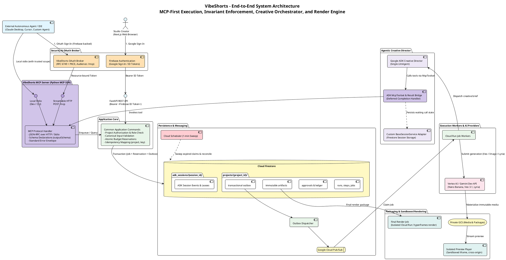
</details>

---

## 2. VibeShorts MCP Server Architecture & Dual Binding

> *"MCP is the first product interface to build. Expose the official Python MCP SDK over Streamable HTTP at `/mcp`; a local stdio entry point can reuse the adapter... Both native and MCP bindings submit the same application commands. Dedicated internal handlers execute accepted jobs."*
>
> — **README.md § Transport and execution boundary**

The VibeShorts MCP Server acts as the core interface bridge for both external tools and the internal ADK Creative Director.

### The 15 Public MCP Tools:

| Domain | Public MCP Tool | Common Capability | Behavior & Contract |
|---|---|---|---|
| **Creative Generation** | `generate_image` | `image.generate` | Submits image job (Gemini Flash / Nano Banana) |
| | `generate_video` | `video.generate` | Submits plate job (Veo 3.1); requires first-frame artifact |
| | `generate_music` | `music.generate` | Submits instrumental music job (Lyria 2) |
| **Media Preparation** | `inspect_media` | `media.inspect` | Returns duration, resolution, fps, codecs, and streams |
| | `extract_frame` | `media.extract_frame` | Extracts exact anchor frame at timestamp $t$ |
| | `prepare_media` | `media.prepare` | Normalizes, crops to 9:16, trims, and adjusts audio |
| **HyperFrames Composition** | `get_hyperframe` | `composition.read` | Reads immutable package manifest and file hashes |
| | `create_hyperframe` | `composition.write` | Submits validated package against expected head |
| | `update_hyperframe` | `composition.write` | Submits incremental revisions; enforces CAS check |
| | `render_hyperframe` | `render.enqueue` | Enqueues draft check or approved final Cloud Run export |
| **Brand & Context** | `get_brand_dna` | `brand.read` | Reads immutable, versioned project brand bundle |
| | `get_project_context` | `project.read` | Returns bounded summary (no heavy byte payloads) |
| | `list_assets` | `artifact.list` | Paginated authorized asset metadata |
| | `get_asset` | `artifact.read` | Fetches asset details and short-lived 5-min signed URL |
| | `get_capabilities` | `provider.capabilities` | Reads supported route/model/parameter combinations |
| **Workflow & Lifecycle** | `get_job` | `job.read` | Reads status, typed progress, artifacts, costs |
| | `get_run` | `run.read` | Reads workflow steps and pending approval ID |
| | `cancel_job` | `job.cancel` | Requests cancellation of running operation |
| | `cancel_run` | `run.cancel` | Cancels overarching workflow and child steps |
| | `create_video` | `run.create` | Submits natural-language brief to director workflow |

![MCP Server Architecture & Tool Surface](https://www.plantuml.com/plantuml/svg/RLRTJjj85BxtKvmDKaMrP2ajj2MggX8dARHG44cx5yig6jidoHHxnZipvgUhIlii-sZx9FlDs4bC02vWpfpVRxvpZZzO9uohYZpwnIsuO2fp8LLahwKgXH459IAzdXjTgIpMkJQqDGe_BGsx49c-bMfECv5RRjqqPaQneRSjUSOpKULkf9Nx8X2pSypv3JkPYiuETOwC53d-iKBPhcKZPq-RZkKFfhsNKUIaovc-oOJ72ssSfRFuWiPiRX2sIuZFT6JIXNISkihm3WqgaLDVgWn9Mtf6UmVTYTOvZIip4ob7aKWTIkqCxnmR1TsZEIj7ktGo65wfxJWNLSOqO7ljT0bnN1aB_LsQi2aa39vtI5ZYEpSLmN9hk3Sw60sZL1UbLbxI-QZr75aV3JvJR5WuUGEFqh2FZ1XZf8RhqxoeOv-Z0BRE25pNtaLslV8-6BuPlOxQxbjed1zLRa5zew_PUxuSnVJwpVxX3bryZeSxD4BGH5YciPohxecglMi1esaIZFoR3r_qWNG9CY3c0_SjiBSlxjr2greq-5nxAj9ockWxsXhinVl3G_ex8f8Am7gegJDsgBuG2OezdamkhjJ5-NX2kx2gCIod2-TAskg_EXmC-fksGcN2P7IoUtwbhCkaNXg5myeAPYriV7eNHZkTuis7QYuLNwakNV9V5I2cIrqX0cWHS9i00KNVF0sbnwzBOxn48M0uqoP5oy3bzgVn-PVbnJE2Wx9ozV5vC5acEZG6H05SeBZyWLS7Mjkfpa1AmyxSUnns2FJ3nHe-3Zak4VJLp7IU8SVEtW5TL4akqu2v9x6bxQ_Avvg58yN2YLpFQsSEacbZspHoU0-YFzubxrSy_CZes93Skzta_PNwxvz_QLxBU2eBC613TYCprXkoeh8o_JD4dKA8UF5mVnYlefrn9WNUWNrZ1o20k4f1AhkEAfKjqHBJmYlN8dIL0K3J6SP1aqSPd72jrOJqib3Zg-6BLSpZ-vBDo1jQp0KGmihDAjrquPLQtbCF2pyILsNsbDYm0hejSPEFvnywzSNevMXlbK_VW1Ue6spyZZAH4yXzvnxcatYbQQR4MbJM-d0QzEkBN5hC6slPsRLcEA-FgIX58dDKpNQPcBjRJP1bNhzhSptBzQr_aXB1RZ3O7oRrNIVhWwbK0vLGAUVho-Qylg-X37Hfmj_E4Ftjw02y9leP_MmDcVQOfZDE5q99MtWM-x4P29tKj_M0mOZ5Ro1qgzlFoq2kenwTfMNe40_8ziRSeJINNXs8AWxjTwL-3TDvm3Cs1krqoHQR1uDKPdD-lWe_HOUkMlEfoFqUVQdxgga5qK-rcbzMIk4qgbI8vrExKgd8qS9mKi3I_y7RMyh2OiZlMr5LxNBvSctSy6IO27LF3UyuhS9_VW_MYwCiGHp3Izmt0Olhu6qlSPC8Cf-0s5aWgkz2YotYTvwrKCEXNm4RvtVgISRmw5YbJTPrJTEqG3th5qSFYR1zEd6kgoni8uiTXsxQ_gGJk3nbNEFlUUNmoZjOvKxEVEZQRPQ4BZ-Czpq6wvNRxRv_kCHwjFTR6EdQuCCXUd3dbPURfaTznZ0n_hrrXGbVhu0DrwiLqwDJZKUZ-FG4ewa16ryGg-tijLSywT5N5BCUrkoYrTt399hXxTcW_Mxr97tAQyE3nd53j0U-6mrlqNw3NlEvGIUgY_cJihKX7a1ial0Mw_KJhKhUa4Uj5UMlmhX_BFG3-R7Ky-u9gRjxBBoTuLClh9B7fOohf93WdGliRFecQhR0XdhK3ECdn1Y5ZwMOK9l2g1tTNuA5FJfoki0cdc1Ustg5Hn-m3V1n_Jy)

> 🔍 **Interactive Links:** [Open Fullscreen SVG](https://www.plantuml.com/plantuml/svg/RLRTJjj85BxtKvmDKaMrP2ajj2MggX8dARHG44cx5yig6jidoHHxnZipvgUhIlii-sZx9FlDs4bC02vWpfpVRxvpZZzO9uohYZpwnIsuO2fp8LLahwKgXH459IAzdXjTgIpMkJQqDGe_BGsx49c-bMfECv5RRjqqPaQneRSjUSOpKULkf9Nx8X2pSypv3JkPYiuETOwC53d-iKBPhcKZPq-RZkKFfhsNKUIaovc-oOJ72ssSfRFuWiPiRX2sIuZFT6JIXNISkihm3WqgaLDVgWn9Mtf6UmVTYTOvZIip4ob7aKWTIkqCxnmR1TsZEIj7ktGo65wfxJWNLSOqO7ljT0bnN1aB_LsQi2aa39vtI5ZYEpSLmN9hk3Sw60sZL1UbLbxI-QZr75aV3JvJR5WuUGEFqh2FZ1XZf8RhqxoeOv-Z0BRE25pNtaLslV8-6BuPlOxQxbjed1zLRa5zew_PUxuSnVJwpVxX3bryZeSxD4BGH5YciPohxecglMi1esaIZFoR3r_qWNG9CY3c0_SjiBSlxjr2greq-5nxAj9ockWxsXhinVl3G_ex8f8Am7gegJDsgBuG2OezdamkhjJ5-NX2kx2gCIod2-TAskg_EXmC-fksGcN2P7IoUtwbhCkaNXg5myeAPYriV7eNHZkTuis7QYuLNwakNV9V5I2cIrqX0cWHS9i00KNVF0sbnwzBOxn48M0uqoP5oy3bzgVn-PVbnJE2Wx9ozV5vC5acEZG6H05SeBZyWLS7Mjkfpa1AmyxSUnns2FJ3nHe-3Zak4VJLp7IU8SVEtW5TL4akqu2v9x6bxQ_Avvg58yN2YLpFQsSEacbZspHoU0-YFzubxrSy_CZes93Skzta_PNwxvz_QLxBU2eBC613TYCprXkoeh8o_JD4dKA8UF5mVnYlefrn9WNUWNrZ1o20k4f1AhkEAfKjqHBJmYlN8dIL0K3J6SP1aqSPd72jrOJqib3Zg-6BLSpZ-vBDo1jQp0KGmihDAjrquPLQtbCF2pyILsNsbDYm0hejSPEFvnywzSNevMXlbK_VW1Ue6spyZZAH4yXzvnxcatYbQQR4MbJM-d0QzEkBN5hC6slPsRLcEA-FgIX58dDKpNQPcBjRJP1bNhzhSptBzQr_aXB1RZ3O7oRrNIVhWwbK0vLGAUVho-Qylg-X37Hfmj_E4Ftjw02y9leP_MmDcVQOfZDE5q99MtWM-x4P29tKj_M0mOZ5Ro1qgzlFoq2kenwTfMNe40_8ziRSeJINNXs8AWxjTwL-3TDvm3Cs1krqoHQR1uDKPdD-lWe_HOUkMlEfoFqUVQdxgga5qK-rcbzMIk4qgbI8vrExKgd8qS9mKi3I_y7RMyh2OiZlMr5LxNBvSctSy6IO27LF3UyuhS9_VW_MYwCiGHp3Izmt0Olhu6qlSPC8Cf-0s5aWgkz2YotYTvwrKCEXNm4RvtVgISRmw5YbJTPrJTEqG3th5qSFYR1zEd6kgoni8uiTXsxQ_gGJk3nbNEFlUUNmoZjOvKxEVEZQRPQ4BZ-Czpq6wvNRxRv_kCHwjFTR6EdQuCCXUd3dbPURfaTznZ0n_hrrXGbVhu0DrwiLqwDJZKUZ-FG4ewa16ryGg-tijLSywT5N5BCUrkoYrTt399hXxTcW_Mxr97tAQyE3nd53j0U-6mrlqNw3NlEvGIUgY_cJihKX7a1ial0Mw_KJhKhUa4Uj5UMlmhX_BFG3-R7Ky-u9gRjxBBoTuLClh9B7fOohf93WdGliRFecQhR0XdhK3ECdn1Y5ZwMOK9l2g1tTNuA5FJfoki0cdc1Ustg5Hn-m3V1n_Jy) · [Edit on PlantUML Server](https://www.plantuml.com/plantuml/uml/RLRTJjj85BxtKvmDKaMrP2ajj2MggX8dARHG44cx5yig6jidoHHxnZipvgUhIlii-sZx9FlDs4bC02vWpfpVRxvpZZzO9uohYZpwnIsuO2fp8LLahwKgXH459IAzdXjTgIpMkJQqDGe_BGsx49c-bMfECv5RRjqqPaQneRSjUSOpKULkf9Nx8X2pSypv3JkPYiuETOwC53d-iKBPhcKZPq-RZkKFfhsNKUIaovc-oOJ72ssSfRFuWiPiRX2sIuZFT6JIXNISkihm3WqgaLDVgWn9Mtf6UmVTYTOvZIip4ob7aKWTIkqCxnmR1TsZEIj7ktGo65wfxJWNLSOqO7ljT0bnN1aB_LsQi2aa39vtI5ZYEpSLmN9hk3Sw60sZL1UbLbxI-QZr75aV3JvJR5WuUGEFqh2FZ1XZf8RhqxoeOv-Z0BRE25pNtaLslV8-6BuPlOxQxbjed1zLRa5zew_PUxuSnVJwpVxX3bryZeSxD4BGH5YciPohxecglMi1esaIZFoR3r_qWNG9CY3c0_SjiBSlxjr2greq-5nxAj9ockWxsXhinVl3G_ex8f8Am7gegJDsgBuG2OezdamkhjJ5-NX2kx2gCIod2-TAskg_EXmC-fksGcN2P7IoUtwbhCkaNXg5myeAPYriV7eNHZkTuis7QYuLNwakNV9V5I2cIrqX0cWHS9i00KNVF0sbnwzBOxn48M0uqoP5oy3bzgVn-PVbnJE2Wx9ozV5vC5acEZG6H05SeBZyWLS7Mjkfpa1AmyxSUnns2FJ3nHe-3Zak4VJLp7IU8SVEtW5TL4akqu2v9x6bxQ_Avvg58yN2YLpFQsSEacbZspHoU0-YFzubxrSy_CZes93Skzta_PNwxvz_QLxBU2eBC613TYCprXkoeh8o_JD4dKA8UF5mVnYlefrn9WNUWNrZ1o20k4f1AhkEAfKjqHBJmYlN8dIL0K3J6SP1aqSPd72jrOJqib3Zg-6BLSpZ-vBDo1jQp0KGmihDAjrquPLQtbCF2pyILsNsbDYm0hejSPEFvnywzSNevMXlbK_VW1Ue6spyZZAH4yXzvnxcatYbQQR4MbJM-d0QzEkBN5hC6slPsRLcEA-FgIX58dDKpNQPcBjRJP1bNhzhSptBzQr_aXB1RZ3O7oRrNIVhWwbK0vLGAUVho-Qylg-X37Hfmj_E4Ftjw02y9leP_MmDcVQOfZDE5q99MtWM-x4P29tKj_M0mOZ5Ro1qgzlFoq2kenwTfMNe40_8ziRSeJINNXs8AWxjTwL-3TDvm3Cs1krqoHQR1uDKPdD-lWe_HOUkMlEfoFqUVQdxgga5qK-rcbzMIk4qgbI8vrExKgd8qS9mKi3I_y7RMyh2OiZlMr5LxNBvSctSy6IO27LF3UyuhS9_VW_MYwCiGHp3Izmt0Olhu6qlSPC8Cf-0s5aWgkz2YotYTvwrKCEXNm4RvtVgISRmw5YbJTPrJTEqG3th5qSFYR1zEd6kgoni8uiTXsxQ_gGJk3nbNEFlUUNmoZjOvKxEVEZQRPQ4BZ-Czpq6wvNRxRv_kCHwjFTR6EdQuCCXUd3dbPURfaTznZ0n_hrrXGbVhu0DrwiLqwDJZKUZ-FG4ewa16ryGg-tijLSywT5N5BCUrkoYrTt399hXxTcW_Mxr97tAQyE3nd53j0U-6mrlqNw3NlEvGIUgY_cJihKX7a1ial0Mw_KJhKhUa4Uj5UMlmhX_BFG3-R7Ky-u9gRjxBBoTuLClh9B7fOohf93WdGliRFecQhR0XdhK3ECdn1Y5ZwMOK9l2g1tTNuA5FJfoki0cdc1Ustg5Hn-m3V1n_Jy)

<details>
<summary><b>Click to view PlantUML Source Code</b></summary>

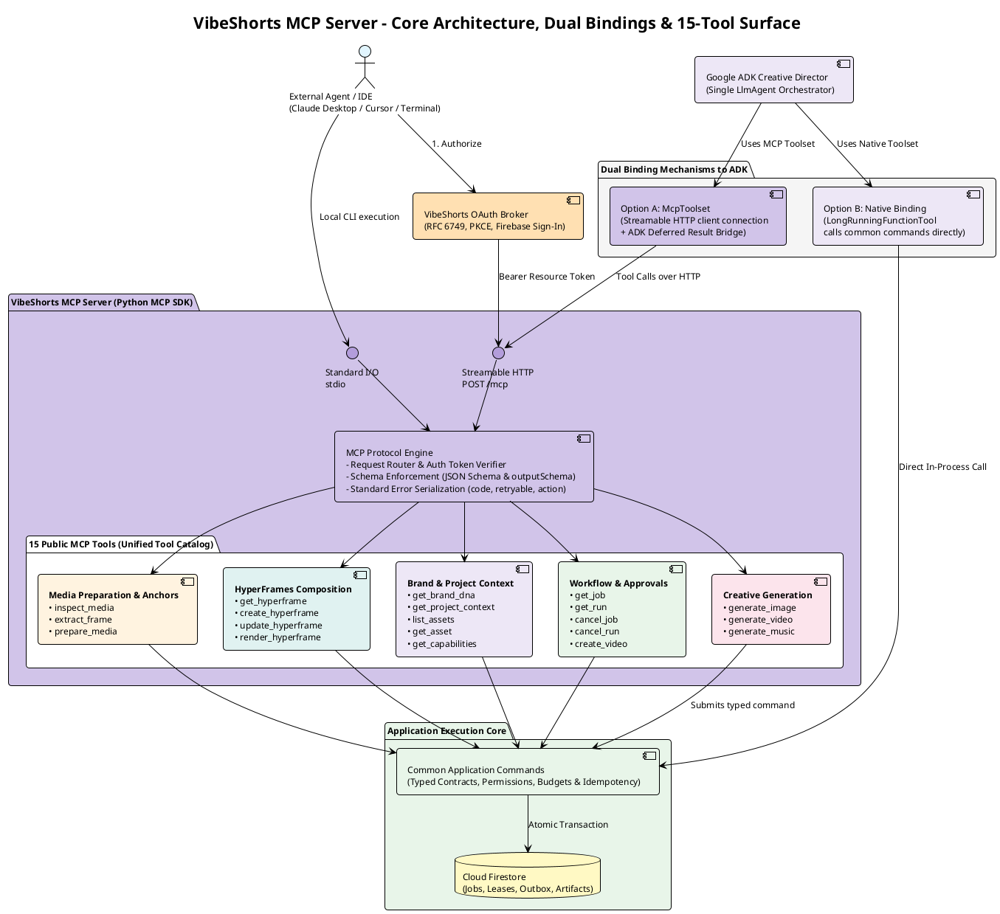
</details>

---

## 3. MCP Asynchronous Invocation & Result Bridge Sequence

> [!NOTE]
> **Asynchronous Tool Philosophy:**
> *"A public tool must not mean 'enqueue' for one caller and 'execute the provider inline' for another... Read calls return directly. Long media, composition, preparation, and render commands return a job handle... MCP discovery alone does not turn a queued result into an ADK deferred completion: implement a result bridge that records pending call/job associations, persists waiting state, and resumes only when the required results are durable."*

This diagram demonstrates how an MCP caller (external agent or ADK Director) triggers asynchronous work, receives an immediate queue response, and polls or receives deferred wake-up:

![MCP Async Invocation Sequence](https://www.plantuml.com/plantuml/svg/hLRRSjD847tNLpHYAvLKvO8XOS55KXXV86mktZXa7mXbnb8x7YpDY9cHmKlbt_VCI3PErbbUrY-sDTFTfq-VxjPhwuHnPPv5Zzo4SwOY4r95TYfL8Op8QIIIwOtHfKhREjE67lV2P-M6dOXKVvFgXiOYixnoKfiPnOQUhrhmrv9LmgTihRZXLYPl52Mi79kLMocFHPcvdbRkJ01P_8wp6JkPY7YRufQH8iCFAvJTiMpaE8f4wRGgyn7SH29nG1ktCmc_j4VTx_2kH4Qj6pouLfiuRNN-eDEakDGQkDrMJC9IRV2us-WTzBeHe22YB0IUnLTon8E9DixIQRjF0pOpDd2rboS5iKeBBLNjnfy_xZJQ-zsNTtsqTPuBbTA9c0VRdh2krJy6Gd-YLOtYj0C8Bte7C4-54oDXGK1F6hP8Yw_L1fsNRgI_XzkTDw4iBzlx4OWjSRDVZlO6vOWshjMRPG7fBsscR899zNCPuswQR1n_fvO7TSMQ02_Oz8sUoTHRzThT_MuxYWuFgR4RSctPkKecHYjTMlA44iBdqbgf5HqUHb7DwywHlzuavpdVIqIMKOo2i16EXzwxZg_LZyBeBvoueKoR51SDb1adUQ4TL3CVJdcEnzFmM1MbQv8to0ktJMDfh1kE8HyU-fJ68dZPfhH4161fqlFRsyWZNY2v4fa4nKpdhT9D06pAYZR89hfWslIK1_8_77Se5qK1dMyjx56b9eJ5IGdp99GlVFdwVWx9x2vo-npvaYvibZ43ViH2wma4nNSofP7n3XAjh3DeHcSNjfqtJRh4eKLMFfTh1VQllFRdzmcwLaztgULqBZt7Su9ml5hfjyRkmHCQWouQbUaDenEUxLBRi4VpNe_e8mQ2A-rX45BwwLhjBuyhnK7epimZQ6vdaSuAff2_T8vJsloYHrK5_OyPw-6JHhnLvR8W_u9TQHGXfag5IIiP1HmTjecH1THUiUrZ1GajZRo4V5wO4RJvVd1-Hb2j0wL1aAncdA64Ms3frUZenpemssHALJqr_b-LElvLoUD9eRDiACOO7KFBg4YAqyQJsrTxewCeKg2RD4P0ZMoxwdfquejk8o92sFR5yULnktKIJleNnsVju_v9jndiYKuqXYOmLjAqTDQzwbxGADCG0QOnlRkyx7iTA0xSxiAaHHKsGXeq0MiPH6H1WwS4ZsMUSofHhMp-AC988WyoD2hqi38AEj8MmYKJYEvj9T55e_h27jNpeRceULfVHwv5QITiVVoe7YArCbl9rnBTGXdxVacmHtBQ74EGQ9aX-W3CRQsOBAP9a_hdWqlQGqts5jqIBKVDpWgMLf9m4PIrv6neU8nwwMBuyiNlyTOzH0C1nTSaBNJzJKZd0Osr6HPrb4-1e6VL91k4UzH7vVrE6yqNA-6NKymDGKfCQwLsUsTc_5cocGUPLwXM6_o2HHgE30HdqZkDLcCxf7XT6bwlHj-W9Ro6QovnALxRSolHxpVO0ysoR8-7Wgzlba0kfiWf2kkNjlox4ji6a8JcxN0cPvuGp_1QWS3nppvPBuuL5MEH5XcZDpUl_0n62HtRjTferIlYWcSoRAeOIsE8Lo0ieofbTWxYgKRbDXQ0cTwPahQ49Zd5eFm_jF4VvGykVvP_6HSOTUcmH9Rh3gH_l9l6ftyL-E61kApnQeILJRh6UpqDVv6-iE0I1ApuQjwZ-_QXIP-p4_uj298vsCcbyklMufqHe-1jUq0VBau8KgImSS7RJFAtw3M67rvh_m4)

> 🔍 **Interactive Links:** [Open Fullscreen SVG](https://www.plantuml.com/plantuml/svg/hLRRSjD847tNLpHYAvLKvO8XOS55KXXV86mktZXa7mXbnb8x7YpDY9cHmKlbt_VCI3PErbbUrY-sDTFTfq-VxjPhwuHnPPv5Zzo4SwOY4r95TYfL8Op8QIIIwOtHfKhREjE67lV2P-M6dOXKVvFgXiOYixnoKfiPnOQUhrhmrv9LmgTihRZXLYPl52Mi79kLMocFHPcvdbRkJ01P_8wp6JkPY7YRufQH8iCFAvJTiMpaE8f4wRGgyn7SH29nG1ktCmc_j4VTx_2kH4Qj6pouLfiuRNN-eDEakDGQkDrMJC9IRV2us-WTzBeHe22YB0IUnLTon8E9DixIQRjF0pOpDd2rboS5iKeBBLNjnfy_xZJQ-zsNTtsqTPuBbTA9c0VRdh2krJy6Gd-YLOtYj0C8Bte7C4-54oDXGK1F6hP8Yw_L1fsNRgI_XzkTDw4iBzlx4OWjSRDVZlO6vOWshjMRPG7fBsscR899zNCPuswQR1n_fvO7TSMQ02_Oz8sUoTHRzThT_MuxYWuFgR4RSctPkKecHYjTMlA44iBdqbgf5HqUHb7DwywHlzuavpdVIqIMKOo2i16EXzwxZg_LZyBeBvoueKoR51SDb1adUQ4TL3CVJdcEnzFmM1MbQv8to0ktJMDfh1kE8HyU-fJ68dZPfhH4161fqlFRsyWZNY2v4fa4nKpdhT9D06pAYZR89hfWslIK1_8_77Se5qK1dMyjx56b9eJ5IGdp99GlVFdwVWx9x2vo-npvaYvibZ43ViH2wma4nNSofP7n3XAjh3DeHcSNjfqtJRh4eKLMFfTh1VQllFRdzmcwLaztgULqBZt7Su9ml5hfjyRkmHCQWouQbUaDenEUxLBRi4VpNe_e8mQ2A-rX45BwwLhjBuyhnK7epimZQ6vdaSuAff2_T8vJsloYHrK5_OyPw-6JHhnLvR8W_u9TQHGXfag5IIiP1HmTjecH1THUiUrZ1GajZRo4V5wO4RJvVd1-Hb2j0wL1aAncdA64Ms3frUZenpemssHALJqr_b-LElvLoUD9eRDiACOO7KFBg4YAqyQJsrTxewCeKg2RD4P0ZMoxwdfquejk8o92sFR5yULnktKIJleNnsVju_v9jndiYKuqXYOmLjAqTDQzwbxGADCG0QOnlRkyx7iTA0xSxiAaHHKsGXeq0MiPH6H1WwS4ZsMUSofHhMp-AC988WyoD2hqi38AEj8MmYKJYEvj9T55e_h27jNpeRceULfVHwv5QITiVVoe7YArCbl9rnBTGXdxVacmHtBQ74EGQ9aX-W3CRQsOBAP9a_hdWqlQGqts5jqIBKVDpWgMLf9m4PIrv6neU8nwwMBuyiNlyTOzH0C1nTSaBNJzJKZd0Osr6HPrb4-1e6VL91k4UzH7vVrE6yqNA-6NKymDGKfCQwLsUsTc_5cocGUPLwXM6_o2HHgE30HdqZkDLcCxf7XT6bwlHj-W9Ro6QovnALxRSolHxpVO0ysoR8-7Wgzlba0kfiWf2kkNjlox4ji6a8JcxN0cPvuGp_1QWS3nppvPBuuL5MEH5XcZDpUl_0n62HtRjTferIlYWcSoRAeOIsE8Lo0ieofbTWxYgKRbDXQ0cTwPahQ49Zd5eFm_jF4VvGykVvP_6HSOTUcmH9Rh3gH_l9l6ftyL-E61kApnQeILJRh6UpqDVv6-iE0I1ApuQjwZ-_QXIP-p4_uj298vsCcbyklMufqHe-1jUq0VBau8KgImSS7RJFAtw3M67rvh_m4) · [Edit on PlantUML Server](https://www.plantuml.com/plantuml/uml/hLRRSjD847tNLpHYAvLKvO8XOS55KXXV86mktZXa7mXbnb8x7YpDY9cHmKlbt_VCI3PErbbUrY-sDTFTfq-VxjPhwuHnPPv5Zzo4SwOY4r95TYfL8Op8QIIIwOtHfKhREjE67lV2P-M6dOXKVvFgXiOYixnoKfiPnOQUhrhmrv9LmgTihRZXLYPl52Mi79kLMocFHPcvdbRkJ01P_8wp6JkPY7YRufQH8iCFAvJTiMpaE8f4wRGgyn7SH29nG1ktCmc_j4VTx_2kH4Qj6pouLfiuRNN-eDEakDGQkDrMJC9IRV2us-WTzBeHe22YB0IUnLTon8E9DixIQRjF0pOpDd2rboS5iKeBBLNjnfy_xZJQ-zsNTtsqTPuBbTA9c0VRdh2krJy6Gd-YLOtYj0C8Bte7C4-54oDXGK1F6hP8Yw_L1fsNRgI_XzkTDw4iBzlx4OWjSRDVZlO6vOWshjMRPG7fBsscR899zNCPuswQR1n_fvO7TSMQ02_Oz8sUoTHRzThT_MuxYWuFgR4RSctPkKecHYjTMlA44iBdqbgf5HqUHb7DwywHlzuavpdVIqIMKOo2i16EXzwxZg_LZyBeBvoueKoR51SDb1adUQ4TL3CVJdcEnzFmM1MbQv8to0ktJMDfh1kE8HyU-fJ68dZPfhH4161fqlFRsyWZNY2v4fa4nKpdhT9D06pAYZR89hfWslIK1_8_77Se5qK1dMyjx56b9eJ5IGdp99GlVFdwVWx9x2vo-npvaYvibZ43ViH2wma4nNSofP7n3XAjh3DeHcSNjfqtJRh4eKLMFfTh1VQllFRdzmcwLaztgULqBZt7Su9ml5hfjyRkmHCQWouQbUaDenEUxLBRi4VpNe_e8mQ2A-rX45BwwLhjBuyhnK7epimZQ6vdaSuAff2_T8vJsloYHrK5_OyPw-6JHhnLvR8W_u9TQHGXfag5IIiP1HmTjecH1THUiUrZ1GajZRo4V5wO4RJvVd1-Hb2j0wL1aAncdA64Ms3frUZenpemssHALJqr_b-LElvLoUD9eRDiACOO7KFBg4YAqyQJsrTxewCeKg2RD4P0ZMoxwdfquejk8o92sFR5yULnktKIJleNnsVju_v9jndiYKuqXYOmLjAqTDQzwbxGADCG0QOnlRkyx7iTA0xSxiAaHHKsGXeq0MiPH6H1WwS4ZsMUSofHhMp-AC988WyoD2hqi38AEj8MmYKJYEvj9T55e_h27jNpeRceULfVHwv5QITiVVoe7YArCbl9rnBTGXdxVacmHtBQ74EGQ9aX-W3CRQsOBAP9a_hdWqlQGqts5jqIBKVDpWgMLf9m4PIrv6neU8nwwMBuyiNlyTOzH0C1nTSaBNJzJKZd0Osr6HPrb4-1e6VL91k4UzH7vVrE6yqNA-6NKymDGKfCQwLsUsTc_5cocGUPLwXM6_o2HHgE30HdqZkDLcCxf7XT6bwlHj-W9Ro6QovnALxRSolHxpVO0ysoR8-7Wgzlba0kfiWf2kkNjlox4ji6a8JcxN0cPvuGp_1QWS3nppvPBuuL5MEH5XcZDpUl_0n62HtRjTferIlYWcSoRAeOIsE8Lo0ieofbTWxYgKRbDXQ0cTwPahQ49Zd5eFm_jF4VvGykVvP_6HSOTUcmH9Rh3gH_l9l6ftyL-E61kApnQeILJRh6UpqDVv6-iE0I1ApuQjwZ-_QXIP-p4_uj298vsCcbyklMufqHe-1jUq0VBau8KgImSS7RJFAtw3M67rvh_m4)

<details>
<summary><b>Click to view PlantUML Source Code</b></summary>

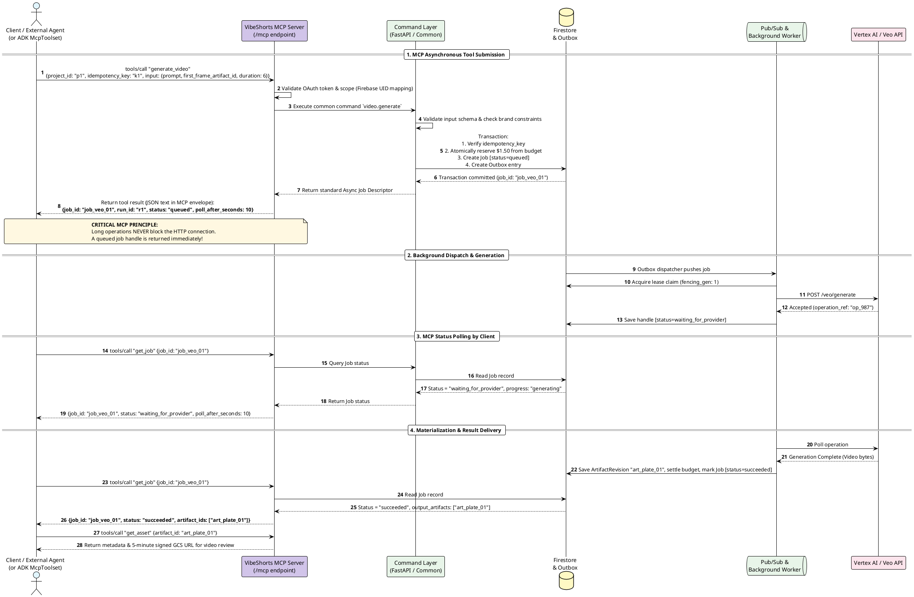
</details>

---

## 4. End-to-End Lifecycle & Two Approval Gates

> *"Storyboard and preview review live in the authenticated app... Do not allow an external model to approve a user's work implicitly."*
>
> — **README.md § Bootstrap and approvals**

VibeShorts enforces **two strict human gates**:
1. **Gate 1 (Storyboard Approval):** Authorizes the creative breakdown, visual prompts, and cost allowance before paid media generation.
2. **Gate 2 (Preview Approval):** Authorizes final export of the exact reviewed composition package.

![Two Gate Lifecycle](https://www.plantuml.com/plantuml/svg/hLThRzf85FtkNt6RIbMYGdWqILEah4e8RhBD0uKqrMfJHOCzm1HxnZipXg3L_lSzCpPWsdIbhPeFmMRk-vvxxl3UMAPjdYR12plbAQSiOK86PYPanZHBQSIYsKIhNCOzbIXDBqF_Lv4mKnQhXP0J6hF4yCf9gQObrtHKrU1_vLn6_8eRmoQycuY9f8XBotL5AkPZbYSsLD9UCqIsSywJERSYOZirskbgmH8y62PDtN0jna70SgjadevW9c2HHRGxFSqP7XxaxgbM2yZjxH0pz0bFBfL-yxGTm1siYen9IpiXCxOxk7YG-4UNRCcrLt1lB_kjy33iRyjtppwIToBc_46U2SsTOw-pUe7YMVzjU1J4pB8HCqWbn9714QTN3_8cjoFrLAYS-WA_wnq4A54EoK4-QWppaPFxhFICQ-C5YsTOFWuF---sGnfeDHSn997rFLVKe8iKPSRdvH9LAogm5eB3Nl-WtzksSRxCk0xH1WuhVJaHadkryn0-cs4xR0N1oGaDfYwTLeSkv0G92INf5GsHs7Aac8vfa30f7JHEJeB05xt-cwjbXmOtmpjgw5mQGci47zDhEjLCndGAq2GShyECuxN7iht0bH-QPwSTwgaq5PPkSqb_0hmsDoUmufnygK4tdd0SShYQCnTFZOhohamKXUkWEIPZDffwGrQjcnMKbNNUogzSTdCruxGGTbe6UNRTTPdEH9BGG2KYMWRhTc-fXagdUS8i9ukInfNY8Bs8TWrmpqsD9gXrodIDh4YHYzdRjeV4XspEgxNjebrZm1pPpeLnfP-t0W1eLU5FMUpSLWibEO_D8yioD9ybNugQGDvrfaFN2WQNdQeFPvelyC7YfM_uX-vTt_Mx6aTfplTOAhXKSnJGsQmLSmD47_TR0T7vfwlkzSR6tStj7wSttTipY0rkR-wxbv2vPubmWHlofQ4HXci6Wa4daMOEFt2NPXOrux506E21icWrgBlcH4gEXKuDEKYci8Mlj1DkHCfOqXjqx0SEOYxeP-6vgfIXlq6JG5Q7TZ0bZsQT_UEy1HAAUUGxu8wz2ezt_da6jEjIMO38e7UkQw-fBujXxqr54jFlQcJM7LimOP7PurZfnwyu-58PkpR215Cc2K-eQmnm_m45qwmSmnw8KyXSsANl3CQRFlBbsCqqJgzo8wAA0agtGVwQ73equQYigBVt3-lZX9bfNNWksHtwvhJM9lTWOCCfzSgahPss2XxwaQV4aLEzsMpJxfkcmSmPg_CKMm7rwkQnK7JAun-xkG9nmsOX-RbxxpeR1CzwcdDLVxFVga-Ax3cSjZOP3VoqeZoWhKtiUmMqjPXCBQbnrHpcFt72Sy60sIcFymI8MtZFM0bvKU0E7JIE6iScU3xybVTRjYWZk1eSLEDV2VQV01vCFPfXAGQB9LXICHLXhfDWCfeglVV_yszlvTyjpVnNpErlOru3z0swWh5ZyCtTJby3CysK4VvjWEi5cwmsnFVPRlHfDmpJZ4ymJ5fbzAxJEgfH-s2SWGZkj4YfMJ_4urMEC7mmffhzUTZnCvAEi5eoxvGtQ5V8c3_jJssQr2XbKep16FjVZLiRddtgpLPvElAqpzoOmJ3MO3dPsC-9C5D0EysntM6zI8clQRb3ZZAYJTBWZDA0YyhnSnSNbuAdXi1yP06P16p0encsuzIjOjzUGv7xRg-YtN_YaSluJBEnsmJ8HzDkeXPrJtMu7RdvBzL-nN90ApOhWT312wCI7_h00L5ljaIxiztfKl7dreNZkjl-_KN_StLNbBSx4j9WcLhZzW37BFfhxD9TNR5F-PFrBl0Dy84jhB1hi-dIROkYgv6xsUBCFGCR3er2kjh5k3WWCpzY-YTtnNRZVzso28N4MTbnx8pAt1rqojFXEeLIxXK0aobjlvasXwHUelBO0mB6EbH5dIvXzNqwtxAYCxG61DQmnOy9eET1NYj27xXsKKbk7JdM7cGeN6nlsysdLlkuIU-BUQx0szz0wwDblQ2t8UUp2e7mKd955aNIAhTPRlVJxE0PFi5ySPOsLgJSADR5lVlzW1yMVX5MBe3kriMjnL2N5yjBZWzNnYkcPrlJO_8emW3n-Dl1kGTlgd9SiCNf35UPHB7uHV0UPSKlhty1)

> 🔍 **Interactive Links:** [Open Fullscreen SVG](https://www.plantuml.com/plantuml/svg/hLThRzf85FtkNt6RIbMYGdWqILEah4e8RhBD0uKqrMfJHOCzm1HxnZipXg3L_lSzCpPWsdIbhPeFmMRk-vvxxl3UMAPjdYR12plbAQSiOK86PYPanZHBQSIYsKIhNCOzbIXDBqF_Lv4mKnQhXP0J6hF4yCf9gQObrtHKrU1_vLn6_8eRmoQycuY9f8XBotL5AkPZbYSsLD9UCqIsSywJERSYOZirskbgmH8y62PDtN0jna70SgjadevW9c2HHRGxFSqP7XxaxgbM2yZjxH0pz0bFBfL-yxGTm1siYen9IpiXCxOxk7YG-4UNRCcrLt1lB_kjy33iRyjtppwIToBc_46U2SsTOw-pUe7YMVzjU1J4pB8HCqWbn9714QTN3_8cjoFrLAYS-WA_wnq4A54EoK4-QWppaPFxhFICQ-C5YsTOFWuF---sGnfeDHSn997rFLVKe8iKPSRdvH9LAogm5eB3Nl-WtzksSRxCk0xH1WuhVJaHadkryn0-cs4xR0N1oGaDfYwTLeSkv0G92INf5GsHs7Aac8vfa30f7JHEJeB05xt-cwjbXmOtmpjgw5mQGci47zDhEjLCndGAq2GShyECuxN7iht0bH-QPwSTwgaq5PPkSqb_0hmsDoUmufnygK4tdd0SShYQCnTFZOhohamKXUkWEIPZDffwGrQjcnMKbNNUogzSTdCruxGGTbe6UNRTTPdEH9BGG2KYMWRhTc-fXagdUS8i9ukInfNY8Bs8TWrmpqsD9gXrodIDh4YHYzdRjeV4XspEgxNjebrZm1pPpeLnfP-t0W1eLU5FMUpSLWibEO_D8yioD9ybNugQGDvrfaFN2WQNdQeFPvelyC7YfM_uX-vTt_Mx6aTfplTOAhXKSnJGsQmLSmD47_TR0T7vfwlkzSR6tStj7wSttTipY0rkR-wxbv2vPubmWHlofQ4HXci6Wa4daMOEFt2NPXOrux506E21icWrgBlcH4gEXKuDEKYci8Mlj1DkHCfOqXjqx0SEOYxeP-6vgfIXlq6JG5Q7TZ0bZsQT_UEy1HAAUUGxu8wz2ezt_da6jEjIMO38e7UkQw-fBujXxqr54jFlQcJM7LimOP7PurZfnwyu-58PkpR215Cc2K-eQmnm_m45qwmSmnw8KyXSsANl3CQRFlBbsCqqJgzo8wAA0agtGVwQ73equQYigBVt3-lZX9bfNNWksHtwvhJM9lTWOCCfzSgahPss2XxwaQV4aLEzsMpJxfkcmSmPg_CKMm7rwkQnK7JAun-xkG9nmsOX-RbxxpeR1CzwcdDLVxFVga-Ax3cSjZOP3VoqeZoWhKtiUmMqjPXCBQbnrHpcFt72Sy60sIcFymI8MtZFM0bvKU0E7JIE6iScU3xybVTRjYWZk1eSLEDV2VQV01vCFPfXAGQB9LXICHLXhfDWCfeglVV_yszlvTyjpVnNpErlOru3z0swWh5ZyCtTJby3CysK4VvjWEi5cwmsnFVPRlHfDmpJZ4ymJ5fbzAxJEgfH-s2SWGZkj4YfMJ_4urMEC7mmffhzUTZnCvAEi5eoxvGtQ5V8c3_jJssQr2XbKep16FjVZLiRddtgpLPvElAqpzoOmJ3MO3dPsC-9C5D0EysntM6zI8clQRb3ZZAYJTBWZDA0YyhnSnSNbuAdXi1yP06P16p0encsuzIjOjzUGv7xRg-YtN_YaSluJBEnsmJ8HzDkeXPrJtMu7RdvBzL-nN90ApOhWT312wCI7_h00L5ljaIxiztfKl7dreNZkjl-_KN_StLNbBSx4j9WcLhZzW37BFfhxD9TNR5F-PFrBl0Dy84jhB1hi-dIROkYgv6xsUBCFGCR3er2kjh5k3WWCpzY-YTtnNRZVzso28N4MTbnx8pAt1rqojFXEeLIxXK0aobjlvasXwHUelBO0mB6EbH5dIvXzNqwtxAYCxG61DQmnOy9eET1NYj27xXsKKbk7JdM7cGeN6nlsysdLlkuIU-BUQx0szz0wwDblQ2t8UUp2e7mKd955aNIAhTPRlVJxE0PFi5ySPOsLgJSADR5lVlzW1yMVX5MBe3kriMjnL2N5yjBZWzNnYkcPrlJO_8emW3n-Dl1kGTlgd9SiCNf35UPHB7uHV0UPSKlhty1) · [Edit on PlantUML Server](https://www.plantuml.com/plantuml/uml/hLThRzf85FtkNt6RIbMYGdWqILEah4e8RhBD0uKqrMfJHOCzm1HxnZipXg3L_lSzCpPWsdIbhPeFmMRk-vvxxl3UMAPjdYR12plbAQSiOK86PYPanZHBQSIYsKIhNCOzbIXDBqF_Lv4mKnQhXP0J6hF4yCf9gQObrtHKrU1_vLn6_8eRmoQycuY9f8XBotL5AkPZbYSsLD9UCqIsSywJERSYOZirskbgmH8y62PDtN0jna70SgjadevW9c2HHRGxFSqP7XxaxgbM2yZjxH0pz0bFBfL-yxGTm1siYen9IpiXCxOxk7YG-4UNRCcrLt1lB_kjy33iRyjtppwIToBc_46U2SsTOw-pUe7YMVzjU1J4pB8HCqWbn9714QTN3_8cjoFrLAYS-WA_wnq4A54EoK4-QWppaPFxhFICQ-C5YsTOFWuF---sGnfeDHSn997rFLVKe8iKPSRdvH9LAogm5eB3Nl-WtzksSRxCk0xH1WuhVJaHadkryn0-cs4xR0N1oGaDfYwTLeSkv0G92INf5GsHs7Aac8vfa30f7JHEJeB05xt-cwjbXmOtmpjgw5mQGci47zDhEjLCndGAq2GShyECuxN7iht0bH-QPwSTwgaq5PPkSqb_0hmsDoUmufnygK4tdd0SShYQCnTFZOhohamKXUkWEIPZDffwGrQjcnMKbNNUogzSTdCruxGGTbe6UNRTTPdEH9BGG2KYMWRhTc-fXagdUS8i9ukInfNY8Bs8TWrmpqsD9gXrodIDh4YHYzdRjeV4XspEgxNjebrZm1pPpeLnfP-t0W1eLU5FMUpSLWibEO_D8yioD9ybNugQGDvrfaFN2WQNdQeFPvelyC7YfM_uX-vTt_Mx6aTfplTOAhXKSnJGsQmLSmD47_TR0T7vfwlkzSR6tStj7wSttTipY0rkR-wxbv2vPubmWHlofQ4HXci6Wa4daMOEFt2NPXOrux506E21icWrgBlcH4gEXKuDEKYci8Mlj1DkHCfOqXjqx0SEOYxeP-6vgfIXlq6JG5Q7TZ0bZsQT_UEy1HAAUUGxu8wz2ezt_da6jEjIMO38e7UkQw-fBujXxqr54jFlQcJM7LimOP7PurZfnwyu-58PkpR215Cc2K-eQmnm_m45qwmSmnw8KyXSsANl3CQRFlBbsCqqJgzo8wAA0agtGVwQ73equQYigBVt3-lZX9bfNNWksHtwvhJM9lTWOCCfzSgahPss2XxwaQV4aLEzsMpJxfkcmSmPg_CKMm7rwkQnK7JAun-xkG9nmsOX-RbxxpeR1CzwcdDLVxFVga-Ax3cSjZOP3VoqeZoWhKtiUmMqjPXCBQbnrHpcFt72Sy60sIcFymI8MtZFM0bvKU0E7JIE6iScU3xybVTRjYWZk1eSLEDV2VQV01vCFPfXAGQB9LXICHLXhfDWCfeglVV_yszlvTyjpVnNpErlOru3z0swWh5ZyCtTJby3CysK4VvjWEi5cwmsnFVPRlHfDmpJZ4ymJ5fbzAxJEgfH-s2SWGZkj4YfMJ_4urMEC7mmffhzUTZnCvAEi5eoxvGtQ5V8c3_jJssQr2XbKep16FjVZLiRddtgpLPvElAqpzoOmJ3MO3dPsC-9C5D0EysntM6zI8clQRb3ZZAYJTBWZDA0YyhnSnSNbuAdXi1yP06P16p0encsuzIjOjzUGv7xRg-YtN_YaSluJBEnsmJ8HzDkeXPrJtMu7RdvBzL-nN90ApOhWT312wCI7_h00L5ljaIxiztfKl7dreNZkjl-_KN_StLNbBSx4j9WcLhZzW37BFfhxD9TNR5F-PFrBl0Dy84jhB1hi-dIROkYgv6xsUBCFGCR3er2kjh5k3WWCpzY-YTtnNRZVzso28N4MTbnx8pAt1rqojFXEeLIxXK0aobjlvasXwHUelBO0mB6EbH5dIvXzNqwtxAYCxG61DQmnOy9eET1NYj27xXsKKbk7JdM7cGeN6nlsysdLlkuIU-BUQx0szz0wwDblQ2t8UUp2e7mKd955aNIAhTPRlVJxE0PFi5ySPOsLgJSADR5lVlzW1yMVX5MBe3kriMjnL2N5yjBZWzNnYkcPrlJO_8emW3n-Dl1kGTlgd9SiCNf35UPHB7uHV0UPSKlhty1)

<details>
<summary><b>Click to view PlantUML Source Code</b></summary>

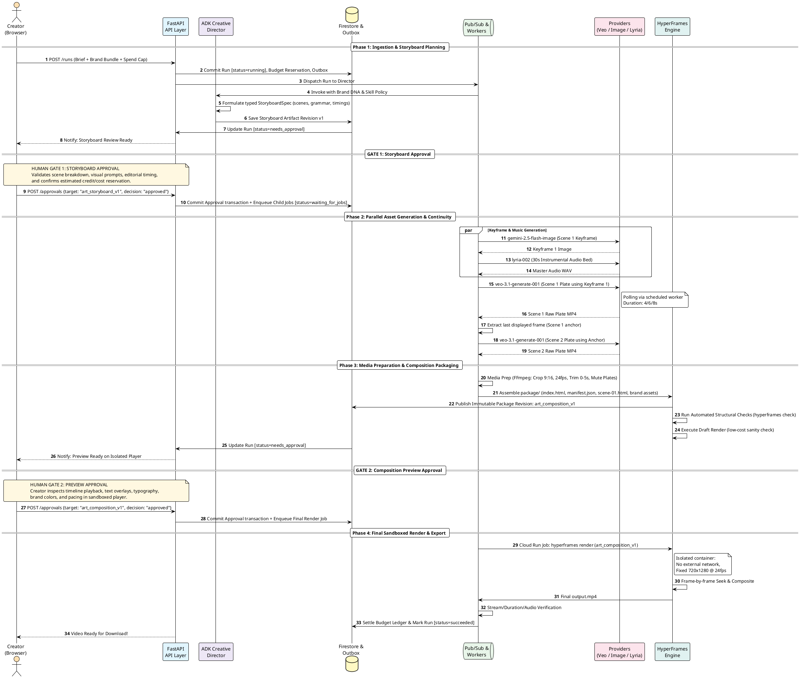
</details>

---

## 5. Run and Job State Machines

> *"A cancel request blocks new work promptly. Already accepted provider work may complete and incur cost... Maintain operational records and reconcile costs even after the user-facing run is cancelled."*
>
> — **README.md § Run and job state**

### 5.1 Run Lifecycle
The `Run` object tracks workflow progress, approval requests, and active step sets:


> 🔍 **Interactive Links:** [Open Fullscreen SVG](https://www.plantuml.com/plantuml/svg/VPHjRzem4CVV-rFSD6dQ9bLLCreegb3LKBOtbIgwTzE4J7A0YsEpimthfdttdHEUaeOI8H7dVx_xtqEuTLwI3uKMx_m22uILbie8jrHc9KaMC9NPSausc3orsXAy7vMV8mKJFC9V0N3tIdiPh_Z4KewqFUqayUBJSIKbWmGzyQ_9lBdvfkOBpLy_69n8C1fTfvrcWj5bTtJHRGCEfPaZdQQbms7IfALNIIzfjVSKiWoTEuLBU_TNwNKJbzntXryIneaVdt_2sTa0VWKCc4CVxaZX30WpL6i--00o-8KbzGTp8RQg643166Nc735KhFQCpNXi1J-Uli36qX99x4Gnm23cRY9NAx9hgUjzxSCJ0rwcLb8EB5XPLt5sR27guILn8vLd-cHcQV9ifuunN-CQN40bgn31iP6Mw9O22DVAAMiS_-9IdUUQMo8pQJBK6lEZMVPXZCzCuPpdaEu4-_pYbTSJ1QGBfNCeRp9Rh3H60IW3SUYCrEsaoYMNOKscj9AUgwYvUvIgxEnQyHR0J2eT2DbgC4jZDwRQfhVOfmQNialhL4p87hEbd9TRavESULWZgPcAc_Fc0Cgf9OUfVHmfmw8nccXskrQVQjlaujfZ7cTmU0FwyF3O0UQhNFhI1i-0Em0ElTVHHck19-OPpE59BNViNaFy7QaeFICHBz8vJ0Cdze2_5p8SxL5zGeqsF4WJ6D7Gv9YLIndteL0-iiI--fB0xx2eFErlzyRt9xVSJFwB_Gy) · [Edit on PlantUML Server](https://www.plantuml.com/plantuml/uml/VPHjRzem4CVV-rFSD6dQ9bLLCreegb3LKBOtbIgwTzE4J7A0YsEpimthfdttdHEUaeOI8H7dVx_xtqEuTLwI3uKMx_m22uILbie8jrHc9KaMC9NPSausc3orsXAy7vMV8mKJFC9V0N3tIdiPh_Z4KewqFUqayUBJSIKbWmGzyQ_9lBdvfkOBpLy_69n8C1fTfvrcWj5bTtJHRGCEfPaZdQQbms7IfALNIIzfjVSKiWoTEuLBU_TNwNKJbzntXryIneaVdt_2sTa0VWKCc4CVxaZX30WpL6i--00o-8KbzGTp8RQg643166Nc735KhFQCpNXi1J-Uli36qX99x4Gnm23cRY9NAx9hgUjzxSCJ0rwcLb8EB5XPLt5sR27guILn8vLd-cHcQV9ifuunN-CQN40bgn31iP6Mw9O22DVAAMiS_-9IdUUQMo8pQJBK6lEZMVPXZCzCuPpdaEu4-_pYbTSJ1QGBfNCeRp9Rh3H60IW3SUYCrEsaoYMNOKscj9AUgwYvUvIgxEnQyHR0J2eT2DbgC4jZDwRQfhVOfmQNialhL4p87hEbd9TRavESULWZgPcAc_Fc0Cgf9OUfVHmfmw8nccXskrQVQjlaujfZ7cTmU0FwyF3O0UQhNFhI1i-0Em0ElTVHHck19-OPpE59BNViNaFy7QaeFICHBz8vJ0Cdze2_5p8SxL5zGeqsF4WJ6D7Gv9YLIndteL0-iiI--fB0xx2eFErlzyRt9xVSJFwB_Gy)

<details>
<summary><b>Click to view PlantUML Source Code</b></summary>

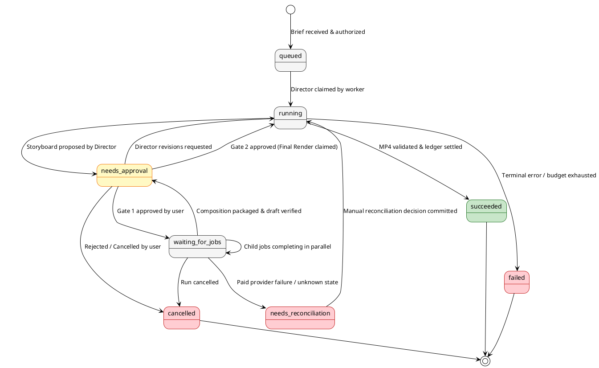
</details>

### 5.2 Individual Job Lifecycle & Leased Execution
Jobs are unit operations claimed by workers using short-lived leases and generation-fenced tokens:


> 🔍 **Interactive Links:** [Open Fullscreen SVG](https://www.plantuml.com/plantuml/svg/ZPLjJzim4CVV-rCScZJ195Zf1kiAGeoqXKcJLb5jl1XJvSQNngfZ1pyKiMdVVUVqWJQasXfLIktpx_xtv5uwpwqFXM9xFiS2eLHSQkPcKfVSyW8cF9rDhGbQ94OP2wy6rMV3WWWUuJS3k7fXUnAVk6EiGBjSVT-E3wtUBaojHWiTzgVEF3-_aTDSqTTVN3Gxw1-JWtxTGQlTwVIEcu1tt6gffxjmWq6_TTMku_gd9yUjLXEkn_KKxMvQqkkze2MdxKwxCTfHI5DqRXSkwVHFauzrNBl_eVUkJJZsuyrFE3oyW8U00GLqeQ-NhvCd84UeFNd2ah7bSZHEgTn5PNrdx8pgmDE782qwKCWTRLG6zte_GvrIvi2R6Mgmc4OHue2j017cmgIGtfFPTkcwS1N453sK5W-9ZNQEuknU9rofo2ojcKiA2JuDFpFsJAcWZrp6zt5cx7XbMCVVS2qKWkF4XNqycXx1TpJmvVOhASqEoDKGhJH2fbK_coo3qbI-wzuAgeILNCbVSQKBeoUTvjPe4rnKHpWVh7QKKayvsh_6Gce90yLTVb1dLJ-TaqQFWvvfywWtEgOBYQL3y1OyvSy43nEa417oZLZs66iAlr7fSBMPaIANaxefqc1nJ_vtK_wXSRZ84cHSga3Y7gNFerPoJO5pLRLkSCkYRN4QHIRA106ZD4SH54c8VKHzfKZjNF9LxCgOMIXtCQCM55iol-a8cbEq4uLdv5K7qYOmbV4qUQbwMZ2shMUH01ew517uF7yar6WV1sPEje8E2NWDT57AZATnYgXG0gI6wsJKm6nGU1DhJT6GSHgBJkDZGncv6Tq0I1dS7AIKwnJLEEf66bcnUN5Hj3H0X71Fj5KiRNTN-3zOIqJTSkDuFPnriwstWIuZFg7w6HqJlKvh1Q6hYIsIilxvV72rSebQq1_HNm) · [Edit on PlantUML Server](https://www.plantuml.com/plantuml/uml/ZPLjJzim4CVV-rCScZJ195Zf1kiAGeoqXKcJLb5jl1XJvSQNngfZ1pyKiMdVVUVqWJQasXfLIktpx_xtv5uwpwqFXM9xFiS2eLHSQkPcKfVSyW8cF9rDhGbQ94OP2wy6rMV3WWWUuJS3k7fXUnAVk6EiGBjSVT-E3wtUBaojHWiTzgVEF3-_aTDSqTTVN3Gxw1-JWtxTGQlTwVIEcu1tt6gffxjmWq6_TTMku_gd9yUjLXEkn_KKxMvQqkkze2MdxKwxCTfHI5DqRXSkwVHFauzrNBl_eVUkJJZsuyrFE3oyW8U00GLqeQ-NhvCd84UeFNd2ah7bSZHEgTn5PNrdx8pgmDE782qwKCWTRLG6zte_GvrIvi2R6Mgmc4OHue2j017cmgIGtfFPTkcwS1N453sK5W-9ZNQEuknU9rofo2ojcKiA2JuDFpFsJAcWZrp6zt5cx7XbMCVVS2qKWkF4XNqycXx1TpJmvVOhASqEoDKGhJH2fbK_coo3qbI-wzuAgeILNCbVSQKBeoUTvjPe4rnKHpWVh7QKKayvsh_6Gce90yLTVb1dLJ-TaqQFWvvfywWtEgOBYQL3y1OyvSy43nEa417oZLZs66iAlr7fSBMPaIANaxefqc1nJ_vtK_wXSRZ84cHSga3Y7gNFerPoJO5pLRLkSCkYRN4QHIRA106ZD4SH54c8VKHzfKZjNF9LxCgOMIXtCQCM55iol-a8cbEq4uLdv5K7qYOmbV4qUQbwMZ2shMUH01ew517uF7yar6WV1sPEje8E2NWDT57AZATnYgXG0gI6wsJKm6nGU1DhJT6GSHgBJkDZGncv6Tq0I1dS7AIKwnJLEEf66bcnUN5Hj3H0X71Fj5KiRNTN-3zOIqJTSkDuFPnriwstWIuZFg7w6HqJlKvh1Q6hYIsIilxvV72rSebQq1_HNm)

<details>
<summary><b>Click to view PlantUML Source Code</b></summary>

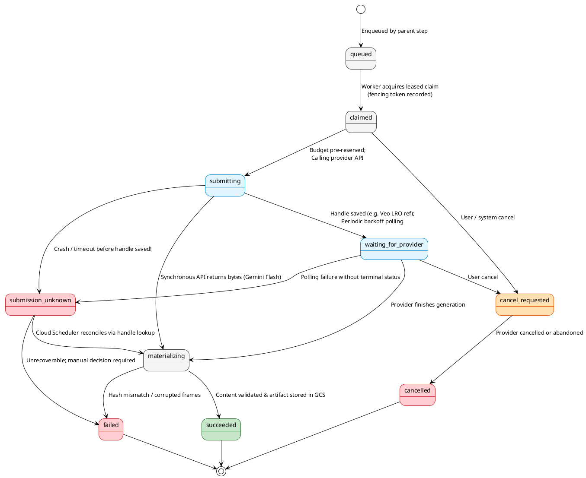
</details>

---

## 6. Durable Execution, Outbox Pattern & Crash Recovery

> [!CAUTION]
> **Paid Submission Recovery:**
> *"If a process dies after sending a request but before saving the handle, the provider may already be generating. Mark the job `submission_unknown` and the live run `needs_reconciliation`... Never automatically claim that the original operation cost nothing."*

This sequence illustrates how VibeShorts prevents ghost duplicate orders, duplicate billing, and lost tasks when server crashes occur.

![Crash Recovery](https://www.plantuml.com/plantuml/svg/TLLTK-D647pNhvY3gfHTmIPSWEIeSkf0bWkI0pis7myvohMMnlQUfLtTxihWVv_UbGmcN7YmZRPtPhgdP_JPEc5SLUJH1xVaWgdCXLIHNKbL2YCAcebqjJ2wKbciSsreVn3-TX1sAJBz9DM2vYAtl7FIN3EA3PtkFCzuBghS3RHoDm8vzouvNxEJgTWxeBrp8qME7rOesx5iv3oAS0_7iXJAqTv0M7S-kg9BeRASpHu9I_x__UHeS398eamuCHCMSGVIi7NQCFKl0gn_4GXyYe-ZxnLNW8ogsU6aceNJqGGnVX-S99_U9dpGPWKA8wDJjZP0cqVxIJ_vRN3w5dxFnl4ptRFsPGMu_xq_Y9FZ97wBZNDTPJH9bvnLuF9LjOuwXLGqvbIhLE9HEmHuGVZwutx_OnJrUdJKfLi3cKJgf5OYfs7bPlgPGAYGrk8PzNgHrwRp1xYVqGKl4FnLbftRPv7IZid8nTAHdWCUaKzmxpkmeLPfz3TEtLHc1oGpBagWLRgPhdZJ1l9Z5pMZMskcYofRiAEvqS4SXZCIQGelE2grpW7-jKjN2c17V-eP6N0r6Vq3AxhAza9ZiaV0ZbzW3QyhnyKBhcILmNMF4Rx9rxvBDDP58Tqkl_eKn_W-GwskCeg-wHa8aImApgHmd6_8QKf53gM3mg3LvEvBMmgNBdSK7KtE2Fx9fLsIhb45328M7C5A0DGkyI0WaCkNAUVmUIZ8nuSIiH4ulU2vRqZjQHgniT9wWPbQT_Wq3cFfDl01As6aRlio6XCsbC_JxnKQIr_OUp_671VKukTIcWtrwEVJN-m1pH4HclKMhAP7xPq0C2ZA74vkwN3D-X3dRA07jKO2-gpHS8q-eJNMjQDkjqiFm_5VoPZYyVdaCfdGPJ9Eg3KSNjCXZNH6oLe6rTi4SEqilKQgxTmq9YQwNV9sKhnBk7Im2rRHDXj149f9D2IZ55QIxW2tPfKBeASwN2PnEgiLB6lf_3xIfIU1AgQ6vnzUVUA5XxTUPshon5pIJpjJHmzYnPsgz3A_uXgbqHsfCvdIKUTQgWhSGe3tm854oj02r9U7lc0alUUt9hP-KfqBFdvt_LgOrNjqcEjffLPAFwd7hogWnfLwGIdcp4vDmqK61Hu3wPFk2yNwiTzfJgSwVySp6EBlYc4UJButW7dLqnAazdFBcEcTPK1O1f78dGzRNsdy_4N3yvoXSpyIq_VhRREm_R51jeIUXFGAJP5qkYtcyR-n_32EkPDjnnHpNEeyzpu86oLYl9nekCr2TxM0tg_ROk-KhSfIc_-fz5BdS5czt4pOTNKahEUxcpWPtvvVtH24XLkbs_memhZnTCqL4XvIXJZqjbTuFwRIDzaxDlgC3xoV_mK)

> 🔍 **Interactive Links:** [Open Fullscreen SVG](https://www.plantuml.com/plantuml/svg/TLLTK-D647pNhvY3gfHTmIPSWEIeSkf0bWkI0pis7myvohMMnlQUfLtTxihWVv_UbGmcN7YmZRPtPhgdP_JPEc5SLUJH1xVaWgdCXLIHNKbL2YCAcebqjJ2wKbciSsreVn3-TX1sAJBz9DM2vYAtl7FIN3EA3PtkFCzuBghS3RHoDm8vzouvNxEJgTWxeBrp8qME7rOesx5iv3oAS0_7iXJAqTv0M7S-kg9BeRASpHu9I_x__UHeS398eamuCHCMSGVIi7NQCFKl0gn_4GXyYe-ZxnLNW8ogsU6aceNJqGGnVX-S99_U9dpGPWKA8wDJjZP0cqVxIJ_vRN3w5dxFnl4ptRFsPGMu_xq_Y9FZ97wBZNDTPJH9bvnLuF9LjOuwXLGqvbIhLE9HEmHuGVZwutx_OnJrUdJKfLi3cKJgf5OYfs7bPlgPGAYGrk8PzNgHrwRp1xYVqGKl4FnLbftRPv7IZid8nTAHdWCUaKzmxpkmeLPfz3TEtLHc1oGpBagWLRgPhdZJ1l9Z5pMZMskcYofRiAEvqS4SXZCIQGelE2grpW7-jKjN2c17V-eP6N0r6Vq3AxhAza9ZiaV0ZbzW3QyhnyKBhcILmNMF4Rx9rxvBDDP58Tqkl_eKn_W-GwskCeg-wHa8aImApgHmd6_8QKf53gM3mg3LvEvBMmgNBdSK7KtE2Fx9fLsIhb45328M7C5A0DGkyI0WaCkNAUVmUIZ8nuSIiH4ulU2vRqZjQHgniT9wWPbQT_Wq3cFfDl01As6aRlio6XCsbC_JxnKQIr_OUp_671VKukTIcWtrwEVJN-m1pH4HclKMhAP7xPq0C2ZA74vkwN3D-X3dRA07jKO2-gpHS8q-eJNMjQDkjqiFm_5VoPZYyVdaCfdGPJ9Eg3KSNjCXZNH6oLe6rTi4SEqilKQgxTmq9YQwNV9sKhnBk7Im2rRHDXj149f9D2IZ55QIxW2tPfKBeASwN2PnEgiLB6lf_3xIfIU1AgQ6vnzUVUA5XxTUPshon5pIJpjJHmzYnPsgz3A_uXgbqHsfCvdIKUTQgWhSGe3tm854oj02r9U7lc0alUUt9hP-KfqBFdvt_LgOrNjqcEjffLPAFwd7hogWnfLwGIdcp4vDmqK61Hu3wPFk2yNwiTzfJgSwVySp6EBlYc4UJButW7dLqnAazdFBcEcTPK1O1f78dGzRNsdy_4N3yvoXSpyIq_VhRREm_R51jeIUXFGAJP5qkYtcyR-n_32EkPDjnnHpNEeyzpu86oLYl9nekCr2TxM0tg_ROk-KhSfIc_-fz5BdS5czt4pOTNKahEUxcpWPtvvVtH24XLkbs_memhZnTCqL4XvIXJZqjbTuFwRIDzaxDlgC3xoV_mK) · [Edit on PlantUML Server](https://www.plantuml.com/plantuml/uml/TLLTK-D647pNhvY3gfHTmIPSWEIeSkf0bWkI0pis7myvohMMnlQUfLtTxihWVv_UbGmcN7YmZRPtPhgdP_JPEc5SLUJH1xVaWgdCXLIHNKbL2YCAcebqjJ2wKbciSsreVn3-TX1sAJBz9DM2vYAtl7FIN3EA3PtkFCzuBghS3RHoDm8vzouvNxEJgTWxeBrp8qME7rOesx5iv3oAS0_7iXJAqTv0M7S-kg9BeRASpHu9I_x__UHeS398eamuCHCMSGVIi7NQCFKl0gn_4GXyYe-ZxnLNW8ogsU6aceNJqGGnVX-S99_U9dpGPWKA8wDJjZP0cqVxIJ_vRN3w5dxFnl4ptRFsPGMu_xq_Y9FZ97wBZNDTPJH9bvnLuF9LjOuwXLGqvbIhLE9HEmHuGVZwutx_OnJrUdJKfLi3cKJgf5OYfs7bPlgPGAYGrk8PzNgHrwRp1xYVqGKl4FnLbftRPv7IZid8nTAHdWCUaKzmxpkmeLPfz3TEtLHc1oGpBagWLRgPhdZJ1l9Z5pMZMskcYofRiAEvqS4SXZCIQGelE2grpW7-jKjN2c17V-eP6N0r6Vq3AxhAza9ZiaV0ZbzW3QyhnyKBhcILmNMF4Rx9rxvBDDP58Tqkl_eKn_W-GwskCeg-wHa8aImApgHmd6_8QKf53gM3mg3LvEvBMmgNBdSK7KtE2Fx9fLsIhb45328M7C5A0DGkyI0WaCkNAUVmUIZ8nuSIiH4ulU2vRqZjQHgniT9wWPbQT_Wq3cFfDl01As6aRlio6XCsbC_JxnKQIr_OUp_671VKukTIcWtrwEVJN-m1pH4HclKMhAP7xPq0C2ZA74vkwN3D-X3dRA07jKO2-gpHS8q-eJNMjQDkjqiFm_5VoPZYyVdaCfdGPJ9Eg3KSNjCXZNH6oLe6rTi4SEqilKQgxTmq9YQwNV9sKhnBk7Im2rRHDXj149f9D2IZ55QIxW2tPfKBeASwN2PnEgiLB6lf_3xIfIU1AgQ6vnzUVUA5XxTUPshon5pIJpjJHmzYnPsgz3A_uXgbqHsfCvdIKUTQgWhSGe3tm854oj02r9U7lc0alUUt9hP-KfqBFdvt_LgOrNjqcEjffLPAFwd7hogWnfLwGIdcp4vDmqK61Hu3wPFk2yNwiTzfJgSwVySp6EBlYc4UJButW7dLqnAazdFBcEcTPK1O1f78dGzRNsdy_4N3yvoXSpyIq_VhRREm_R51jeIUXFGAJP5qkYtcyR-n_32EkPDjnnHpNEeyzpu86oLYl9nekCr2TxM0tg_ROk-KhSfIc_-fz5BdS5czt4pOTNKahEUxcpWPtvvVtH24XLkbs_memhZnTCqL4XvIXJZqjbTuFwRIDzaxDlgC3xoV_mK)

<details>
<summary><b>Click to view PlantUML Source Code</b></summary>

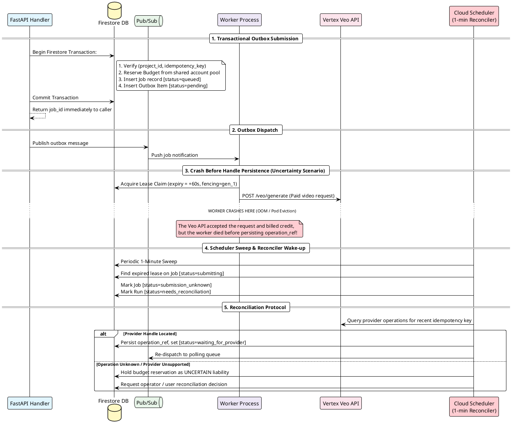
</details>

---

## 7. Media Pipeline & Shot Continuity DAG

> *"For a continuous cut, the next scene depends on the last displayed frame of the preceding trimmed plate, not automatically the raw source's final frame... extract_frame produces an immutable anchor artifact."*
>
> — **README.md § Timing and continuity**

Below is the dependency graph showing how keyframes, Veo plates, editorial trims, anchor extractions, music, brand typography, and final composition bundling interact for a 15-second short.

![Media DAG](https://www.plantuml.com/plantuml/svg/hLThRzis5FtkNt6R0eC2n84bDTbWO4CLHqhS-GN7pJ0KXK5BjCr58WsISciC---xf3nRTQL07keljgHp3m_luuX-hpIHEi_IrXkzfXc5JKeORwaNnZT4aWmM97vPIP7pf2TI8U5jP3ybX5gJH7nXV0LBaYfQUh8FavnA-ALqFw5BagSw4boF2AvvyKZJBTKi9XTNS158HbByeGXNRKKbMxPQckcKWdlJVgAnu0bCf4ZoMCE0v3nUT-6UIHfhci2G9ep0VV00Fq4a3Nc0025HNgkrmRsG5Qvt9mcItA4wP7MUgLHCSF0lBu0esBoivWiB-Bi5yAd0siqhGugYrMU3ivYvqZlaU1lUXpz7jmO_42i1uosLATb1e1JLu62AvodUds-zorAikNK8_QUaxocc7BVRFUnpIhUKfE1q5BJXHXL2LUmM4d-dkwNTgsi2iet-3EtsR_3fWrXquG6f9D4K-fdXTXvenZY3A2LgZM9CFVsmOsYQm2rl83LRabXteRpow07PGZUwYK9aCuJrkAEyPofWafe5NN1k5Jo9NCQqGbWjy4JIFdSm9L_s-E7adQ7hXU_2tdVAQk17WJF9ikF2dUkY1FXLeV4rR8tCYQGu5APphSgQ_5MZZoBfLoqHEBT9TZJyMgUm5bWZRq2KnkbIQ0ixNBOOfh9EBd2p2w6ro40icrDWA41lsf_rUy40UkFHh3_ws9_z2S6ezpYUTkrp6veSGd6sjJ3k05R-bSMCnZD0wmA91RpLQr2sBq1PetY348hZQrHMJ9ZNnS6M5ExmOibmK6zCmTpEOS2yOi0QvwMghprm8YQLRXT-r1DSOGqOfychNVvgM6MrlFDwtclKyzuPFUyrwdclfkU_Bu_VXRtxpW9mNCli7jtFFt4__qptGyC_p_ziG9q3-WqTqAztGB-f0_eD7D0_hnlyHjtWdz4DVgDky1jqGv0dJ20rNjlI4tjjYp_C5OltTGSdJF4K80LdyHMuNcUnoIxB6ndiq3oWqy4-zL7O7y5pnGugGIVIJQgAbV5nkURrc9DqOXlZOQBOs7qUuz5eLPFCIkI9dl-oi4_aDwBAYNpSRQYqVgBiqIHRf3kRqHZpLsTrTU-SFG658ojCYfNCwft8Yzngt_dHZFuFPAnAvTbyvQFX_mosPyEpOm-jyohUqkwlkc0EfwR-GZ6Dn-3vrYqpdhxVNmkpx-F-SFXn5jmDGfY6p_sd_dXKlClRm7X2lrwlDVxPA6vaXBCbLVhwBuN7RsUD5alLvVwXpBbc6SL4n2yMyEsh_3t-nhyj_m8)

> 🔍 **Interactive Links:** [Open Fullscreen SVG](https://www.plantuml.com/plantuml/svg/hLThRzis5FtkNt6R0eC2n84bDTbWO4CLHqhS-GN7pJ0KXK5BjCr58WsISciC---xf3nRTQL07keljgHp3m_luuX-hpIHEi_IrXkzfXc5JKeORwaNnZT4aWmM97vPIP7pf2TI8U5jP3ybX5gJH7nXV0LBaYfQUh8FavnA-ALqFw5BagSw4boF2AvvyKZJBTKi9XTNS158HbByeGXNRKKbMxPQckcKWdlJVgAnu0bCf4ZoMCE0v3nUT-6UIHfhci2G9ep0VV00Fq4a3Nc0025HNgkrmRsG5Qvt9mcItA4wP7MUgLHCSF0lBu0esBoivWiB-Bi5yAd0siqhGugYrMU3ivYvqZlaU1lUXpz7jmO_42i1uosLATb1e1JLu62AvodUds-zorAikNK8_QUaxocc7BVRFUnpIhUKfE1q5BJXHXL2LUmM4d-dkwNTgsi2iet-3EtsR_3fWrXquG6f9D4K-fdXTXvenZY3A2LgZM9CFVsmOsYQm2rl83LRabXteRpow07PGZUwYK9aCuJrkAEyPofWafe5NN1k5Jo9NCQqGbWjy4JIFdSm9L_s-E7adQ7hXU_2tdVAQk17WJF9ikF2dUkY1FXLeV4rR8tCYQGu5APphSgQ_5MZZoBfLoqHEBT9TZJyMgUm5bWZRq2KnkbIQ0ixNBOOfh9EBd2p2w6ro40icrDWA41lsf_rUy40UkFHh3_ws9_z2S6ezpYUTkrp6veSGd6sjJ3k05R-bSMCnZD0wmA91RpLQr2sBq1PetY348hZQrHMJ9ZNnS6M5ExmOibmK6zCmTpEOS2yOi0QvwMghprm8YQLRXT-r1DSOGqOfychNVvgM6MrlFDwtclKyzuPFUyrwdclfkU_Bu_VXRtxpW9mNCli7jtFFt4__qptGyC_p_ziG9q3-WqTqAztGB-f0_eD7D0_hnlyHjtWdz4DVgDky1jqGv0dJ20rNjlI4tjjYp_C5OltTGSdJF4K80LdyHMuNcUnoIxB6ndiq3oWqy4-zL7O7y5pnGugGIVIJQgAbV5nkURrc9DqOXlZOQBOs7qUuz5eLPFCIkI9dl-oi4_aDwBAYNpSRQYqVgBiqIHRf3kRqHZpLsTrTU-SFG658ojCYfNCwft8Yzngt_dHZFuFPAnAvTbyvQFX_mosPyEpOm-jyohUqkwlkc0EfwR-GZ6Dn-3vrYqpdhxVNmkpx-F-SFXn5jmDGfY6p_sd_dXKlClRm7X2lrwlDVxPA6vaXBCbLVhwBuN7RsUD5alLvVwXpBbc6SL4n2yMyEsh_3t-nhyj_m8) · [Edit on PlantUML Server](https://www.plantuml.com/plantuml/uml/hLThRzis5FtkNt6R0eC2n84bDTbWO4CLHqhS-GN7pJ0KXK5BjCr58WsISciC---xf3nRTQL07keljgHp3m_luuX-hpIHEi_IrXkzfXc5JKeORwaNnZT4aWmM97vPIP7pf2TI8U5jP3ybX5gJH7nXV0LBaYfQUh8FavnA-ALqFw5BagSw4boF2AvvyKZJBTKi9XTNS158HbByeGXNRKKbMxPQckcKWdlJVgAnu0bCf4ZoMCE0v3nUT-6UIHfhci2G9ep0VV00Fq4a3Nc0025HNgkrmRsG5Qvt9mcItA4wP7MUgLHCSF0lBu0esBoivWiB-Bi5yAd0siqhGugYrMU3ivYvqZlaU1lUXpz7jmO_42i1uosLATb1e1JLu62AvodUds-zorAikNK8_QUaxocc7BVRFUnpIhUKfE1q5BJXHXL2LUmM4d-dkwNTgsi2iet-3EtsR_3fWrXquG6f9D4K-fdXTXvenZY3A2LgZM9CFVsmOsYQm2rl83LRabXteRpow07PGZUwYK9aCuJrkAEyPofWafe5NN1k5Jo9NCQqGbWjy4JIFdSm9L_s-E7adQ7hXU_2tdVAQk17WJF9ikF2dUkY1FXLeV4rR8tCYQGu5APphSgQ_5MZZoBfLoqHEBT9TZJyMgUm5bWZRq2KnkbIQ0ixNBOOfh9EBd2p2w6ro40icrDWA41lsf_rUy40UkFHh3_ws9_z2S6ezpYUTkrp6veSGd6sjJ3k05R-bSMCnZD0wmA91RpLQr2sBq1PetY348hZQrHMJ9ZNnS6M5ExmOibmK6zCmTpEOS2yOi0QvwMghprm8YQLRXT-r1DSOGqOfychNVvgM6MrlFDwtclKyzuPFUyrwdclfkU_Bu_VXRtxpW9mNCli7jtFFt4__qptGyC_p_ziG9q3-WqTqAztGB-f0_eD7D0_hnlyHjtWdz4DVgDky1jqGv0dJ20rNjlI4tjjYp_C5OltTGSdJF4K80LdyHMuNcUnoIxB6ndiq3oWqy4-zL7O7y5pnGugGIVIJQgAbV5nkURrc9DqOXlZOQBOs7qUuz5eLPFCIkI9dl-oi4_aDwBAYNpSRQYqVgBiqIHRf3kRqHZpLsTrTU-SFG658ojCYfNCwft8Yzngt_dHZFuFPAnAvTbyvQFX_mosPyEpOm-jyohUqkwlkc0EfwR-GZ6Dn-3vrYqpdhxVNmkpx-F-SFXn5jmDGfY6p_sd_dXKlClRm7X2lrwlDVxPA6vaXBCbLVhwBuN7RsUD5alLvVwXpBbc6SL4n2yMyEsh_3t-nhyj_m8)

<details>
<summary><b>Click to view PlantUML Source Code</b></summary>

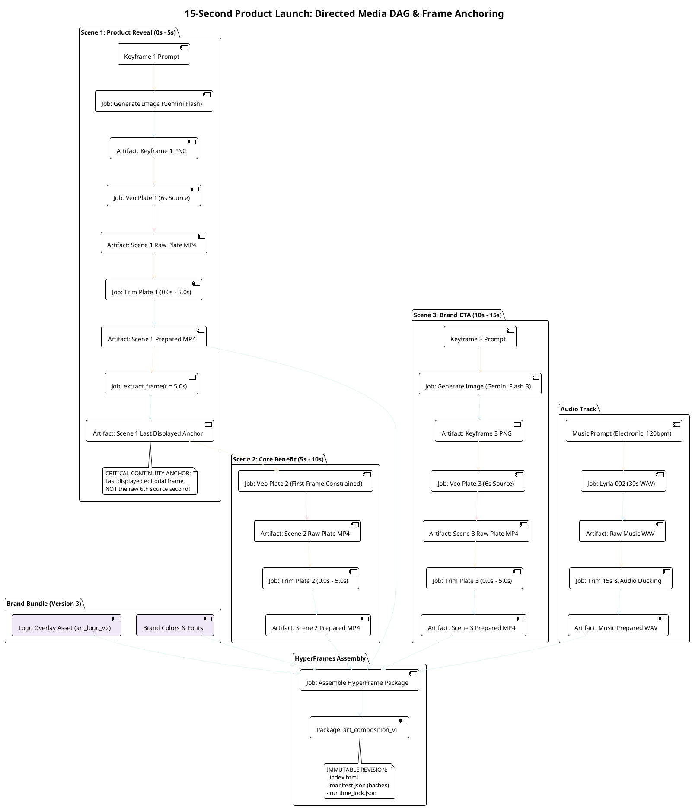
</details>

---

## 8. HyperFrames Security Isolation & Sandbox Boundary

> [!WARNING]
> **Executable Content Risk:**
> *"Treat composition HTML/JavaScript as executable user/agent content. Serve previews on a separate origin inside a sandboxed iframe, without app cookies or arbitrary parent-page access. Run rendering in an isolated browser/container workspace... Deny arbitrary filesystem paths, external network access, and cloud metadata access."*

![Security Sandbox](https://www.plantuml.com/plantuml/svg/RLLjRzj63FwkNy6fmE0KjRDcwSk2hQYdoAc7sWdi5FaIm3X9L7ppwKuudknuG_zxUISvKOmQWb-Ev95ydeVqPtB2kgPIqIzkZHL2hOJK4MsaheKL5MGYtpnOq-WYCSfOU3K9hvv7PxGQBNpidHTOYaQvYT5kBlZc-0kgBJgPY_WDn6ChXU8l93GD2QqiewZcNEB1UnfoS0fBrnJImBYkOI3gUhIL6TBQM4UZt5GdCGY2DRkks0YlqhUJTvCK_ey0s5eRZTf1FCT7D_gNu0upI9JaitizX6-S4GY9fD7mAuZ6hJd8R2IIDu_pd6tWp0OrI0qLLiRklMKYBP8p5a59SiWzKoWZ3rUl6idP-NdgP2bqaPb7BE36ubRY3gQbzMWCwlPthwcXHLsW7MbqRMyokAuuFi3-U_fRwEv5VrCoIZX_ln9xRYfXk9b1jFVwppRUG-nh-Ei-5agPtP1oAsj7z_4dtz4IFLqEmLZv8BK_cbyVm60I-8SokL3Ws_OzYG1Ey1FMcXtKJC6CZxnnV3E50I5ktdWbxVbTD8Glsgb3eTp7z-XxZ_CxOpTSVw0-rLjfZQvyXuD4cQQ0HQEvLBkLUNVRBlYlK6-P-ilqm-JzCVNf8-QDympVMLQ8XuG9H9UlkJ5PLOqJcS8dhafhAhXAbW6KMkmqmJDxpqNyOx8sVtldYnwUo5W49W_n_HuulAs_9NlLaUC9JYulpuvxw5MmvlfaKx5Sl-mvySI3IP1ydRPpWA9GJC8gOqeeuCjFQPIl8pxrQ17NoS9RiEVmMgizfBKVUIjKMr5NoggaJcQbP7XYoNK-ZjQkKd7lj19QbZmAF5j6zms221sTlXvLzVbFptTY6mVsGuNQiFGouno3RyeZL4BuydOnJMuXkPxVZgVpT07fV7AzID9PEh-z21v1iQPncTz4FAyEUHcvJgZF7bV93KmrBppDCCpGYK8uqNd1uEtxFqPdxyv7tITahFeD5YVFyRKrM-dXz2BVu9vuPC92o0InyekADqLkiM3YUBST4YTU9aMtGc1mTlNt2LDO81V90Rn4P0xjdEO-8qSn104MBwsdlGB3uQUN4mGNB3DoLkPUSVqXpDT2QrHH9z4GUYIt2vWnM8wWOhtwLIp_yvUqGewEnHHkwCd3PnO5TOl1yyjOiA9-7dWeumBIIhg3yZbTsKgONMOtvz5dFkO_eXy)

> 🔍 **Interactive Links:** [Open Fullscreen SVG](https://www.plantuml.com/plantuml/svg/RLLjRzj63FwkNy6fmE0KjRDcwSk2hQYdoAc7sWdi5FaIm3X9L7ppwKuudknuG_zxUISvKOmQWb-Ev95ydeVqPtB2kgPIqIzkZHL2hOJK4MsaheKL5MGYtpnOq-WYCSfOU3K9hvv7PxGQBNpidHTOYaQvYT5kBlZc-0kgBJgPY_WDn6ChXU8l93GD2QqiewZcNEB1UnfoS0fBrnJImBYkOI3gUhIL6TBQM4UZt5GdCGY2DRkks0YlqhUJTvCK_ey0s5eRZTf1FCT7D_gNu0upI9JaitizX6-S4GY9fD7mAuZ6hJd8R2IIDu_pd6tWp0OrI0qLLiRklMKYBP8p5a59SiWzKoWZ3rUl6idP-NdgP2bqaPb7BE36ubRY3gQbzMWCwlPthwcXHLsW7MbqRMyokAuuFi3-U_fRwEv5VrCoIZX_ln9xRYfXk9b1jFVwppRUG-nh-Ei-5agPtP1oAsj7z_4dtz4IFLqEmLZv8BK_cbyVm60I-8SokL3Ws_OzYG1Ey1FMcXtKJC6CZxnnV3E50I5ktdWbxVbTD8Glsgb3eTp7z-XxZ_CxOpTSVw0-rLjfZQvyXuD4cQQ0HQEvLBkLUNVRBlYlK6-P-ilqm-JzCVNf8-QDympVMLQ8XuG9H9UlkJ5PLOqJcS8dhafhAhXAbW6KMkmqmJDxpqNyOx8sVtldYnwUo5W49W_n_HuulAs_9NlLaUC9JYulpuvxw5MmvlfaKx5Sl-mvySI3IP1ydRPpWA9GJC8gOqeeuCjFQPIl8pxrQ17NoS9RiEVmMgizfBKVUIjKMr5NoggaJcQbP7XYoNK-ZjQkKd7lj19QbZmAF5j6zms221sTlXvLzVbFptTY6mVsGuNQiFGouno3RyeZL4BuydOnJMuXkPxVZgVpT07fV7AzID9PEh-z21v1iQPncTz4FAyEUHcvJgZF7bV93KmrBppDCCpGYK8uqNd1uEtxFqPdxyv7tITahFeD5YVFyRKrM-dXz2BVu9vuPC92o0InyekADqLkiM3YUBST4YTU9aMtGc1mTlNt2LDO81V90Rn4P0xjdEO-8qSn104MBwsdlGB3uQUN4mGNB3DoLkPUSVqXpDT2QrHH9z4GUYIt2vWnM8wWOhtwLIp_yvUqGewEnHHkwCd3PnO5TOl1yyjOiA9-7dWeumBIIhg3yZbTsKgONMOtvz5dFkO_eXy) · [Edit on PlantUML Server](https://www.plantuml.com/plantuml/uml/RLLjRzj63FwkNy6fmE0KjRDcwSk2hQYdoAc7sWdi5FaIm3X9L7ppwKuudknuG_zxUISvKOmQWb-Ev95ydeVqPtB2kgPIqIzkZHL2hOJK4MsaheKL5MGYtpnOq-WYCSfOU3K9hvv7PxGQBNpidHTOYaQvYT5kBlZc-0kgBJgPY_WDn6ChXU8l93GD2QqiewZcNEB1UnfoS0fBrnJImBYkOI3gUhIL6TBQM4UZt5GdCGY2DRkks0YlqhUJTvCK_ey0s5eRZTf1FCT7D_gNu0upI9JaitizX6-S4GY9fD7mAuZ6hJd8R2IIDu_pd6tWp0OrI0qLLiRklMKYBP8p5a59SiWzKoWZ3rUl6idP-NdgP2bqaPb7BE36ubRY3gQbzMWCwlPthwcXHLsW7MbqRMyokAuuFi3-U_fRwEv5VrCoIZX_ln9xRYfXk9b1jFVwppRUG-nh-Ei-5agPtP1oAsj7z_4dtz4IFLqEmLZv8BK_cbyVm60I-8SokL3Ws_OzYG1Ey1FMcXtKJC6CZxnnV3E50I5ktdWbxVbTD8Glsgb3eTp7z-XxZ_CxOpTSVw0-rLjfZQvyXuD4cQQ0HQEvLBkLUNVRBlYlK6-P-ilqm-JzCVNf8-QDympVMLQ8XuG9H9UlkJ5PLOqJcS8dhafhAhXAbW6KMkmqmJDxpqNyOx8sVtldYnwUo5W49W_n_HuulAs_9NlLaUC9JYulpuvxw5MmvlfaKx5Sl-mvySI3IP1ydRPpWA9GJC8gOqeeuCjFQPIl8pxrQ17NoS9RiEVmMgizfBKVUIjKMr5NoggaJcQbP7XYoNK-ZjQkKd7lj19QbZmAF5j6zms221sTlXvLzVbFptTY6mVsGuNQiFGouno3RyeZL4BuydOnJMuXkPxVZgVpT07fV7AzID9PEh-z21v1iQPncTz4FAyEUHcvJgZF7bV93KmrBppDCCpGYK8uqNd1uEtxFqPdxyv7tITahFeD5YVFyRKrM-dXz2BVu9vuPC92o0InyekADqLkiM3YUBST4YTU9aMtGc1mTlNt2LDO81V90Rn4P0xjdEO-8qSn104MBwsdlGB3uQUN4mGNB3DoLkPUSVqXpDT2QrHH9z4GUYIt2vWnM8wWOhtwLIp_yvUqGewEnHHkwCd3PnO5TOl1yyjOiA9-7dWeumBIIhg3yZbTsKgONMOtvz5dFkO_eXy)

<details>
<summary><b>Click to view PlantUML Source Code</b></summary>

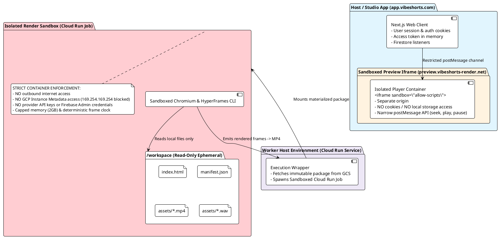
</details>

---

## 9. Entity-Relationship Data Model & Contracts

Core database entities maintain strict immutability, transitive parentage, and separate application truth from conversation history.

![ER Data Model](https://www.plantuml.com/plantuml/svg/ZLR1Rjim3BtdAxGCsA5OBWFMGr4KROTrGpTqHRlRC0YopJXgRCcJvAH6kt_VaoAxJkAuoqdceyJ79vBAkNN2kBei9c_SWafYLI6acjYbL9KmecI9I9UvqRNAFkb26_RsAlnw7dOXChsMAcTpKLZg8N6RKMJOSS-UqLpKXRlIojq8n9n-fM95JgPY-fvDBumK1HPMA3kpPEHyCY7bf6lOzDRe1qhTb0dBAgpPquInex24cSkCdJ3hZ2TpUdhxxUmCy6mMVFGQD7ZTSmdcn0YLyHKPAxK2fEeo8HEWr91mb77XO7Uo96XLLfE_BtGk_UPB95bGe1GEYvm6kHontKXxF5ClimL-VV_Z9bZcq6dBKEXSSroRd8ljf3SHfAr5mQrh2k9EvBQ3V_tkax-hLI1jQXKfOpKguR3CLsrgDIvhZmqqSxMdW73tMDF6MX5KJqN5KzearzFTEcsQH0kJ3IRP3oco9RTalQBxEkpUQI_tUqTLIDvY4RFtoz7qz-NfU1ZwKqk3Mec7R6c-9OEFlD6XH-TQ9u7DWquY6Qn6kGoGVI5pcAVCgAoq8vKsV4dDWQi2dPUhIZ4GIbwGiCH33srlsi3qM4dJRBL9g5m4WYFF2Vk4s-im5DGAb0pN5JSqRskyfyn5B80xGbbZVv2fhOgnJlk_aXsHQly6EWXJ3FmEQgogslKhTwyON5CHR6rkF_7P5Rx8YTT6xeYC2U0ZOjH--7YyWxqwfIughpDcQj0kVaJjsi_HOiCJaPDxjHaDxeZMGqCs9lm5HBjaCqfbxCzsoGcriTdGvd4ef--KvMG-AsUQa5OHlcDIvCsZ6OrTxdZ5W8eiW-03ayiGHk1g6BFaN34CISjhbP9nU7g195gZtTJcH8JYLedABhJhzKTu_9wVPpFz55-T4pPTG8WuzUnqoyNFU3ZuEa8CWDuGiJ020T8ZfRKZWC4IKJ-I0DfAhFq-_ncHhWi18rPMftvlPntmGeiJEYVuzGXq9GcNjP1GPwuDJchDtktvUUkaH2gqbTEXvi9Sw3EBnH0YXWknx5tK7v7FyVJW3yy_)

> 🔍 **Interactive Links:** [Open Fullscreen SVG](https://www.plantuml.com/plantuml/svg/ZLR1Rjim3BtdAxGCsA5OBWFMGr4KROTrGpTqHRlRC0YopJXgRCcJvAH6kt_VaoAxJkAuoqdceyJ79vBAkNN2kBei9c_SWafYLI6acjYbL9KmecI9I9UvqRNAFkb26_RsAlnw7dOXChsMAcTpKLZg8N6RKMJOSS-UqLpKXRlIojq8n9n-fM95JgPY-fvDBumK1HPMA3kpPEHyCY7bf6lOzDRe1qhTb0dBAgpPquInex24cSkCdJ3hZ2TpUdhxxUmCy6mMVFGQD7ZTSmdcn0YLyHKPAxK2fEeo8HEWr91mb77XO7Uo96XLLfE_BtGk_UPB95bGe1GEYvm6kHontKXxF5ClimL-VV_Z9bZcq6dBKEXSSroRd8ljf3SHfAr5mQrh2k9EvBQ3V_tkax-hLI1jQXKfOpKguR3CLsrgDIvhZmqqSxMdW73tMDF6MX5KJqN5KzearzFTEcsQH0kJ3IRP3oco9RTalQBxEkpUQI_tUqTLIDvY4RFtoz7qz-NfU1ZwKqk3Mec7R6c-9OEFlD6XH-TQ9u7DWquY6Qn6kGoGVI5pcAVCgAoq8vKsV4dDWQi2dPUhIZ4GIbwGiCH33srlsi3qM4dJRBL9g5m4WYFF2Vk4s-im5DGAb0pN5JSqRskyfyn5B80xGbbZVv2fhOgnJlk_aXsHQly6EWXJ3FmEQgogslKhTwyON5CHR6rkF_7P5Rx8YTT6xeYC2U0ZOjH--7YyWxqwfIughpDcQj0kVaJjsi_HOiCJaPDxjHaDxeZMGqCs9lm5HBjaCqfbxCzsoGcriTdGvd4ef--KvMG-AsUQa5OHlcDIvCsZ6OrTxdZ5W8eiW-03ayiGHk1g6BFaN34CISjhbP9nU7g195gZtTJcH8JYLedABhJhzKTu_9wVPpFz55-T4pPTG8WuzUnqoyNFU3ZuEa8CWDuGiJ020T8ZfRKZWC4IKJ-I0DfAhFq-_ncHhWi18rPMftvlPntmGeiJEYVuzGXq9GcNjP1GPwuDJchDtktvUUkaH2gqbTEXvi9Sw3EBnH0YXWknx5tK7v7FyVJW3yy_) · [Edit on PlantUML Server](https://www.plantuml.com/plantuml/uml/ZLR1Rjim3BtdAxGCsA5OBWFMGr4KROTrGpTqHRlRC0YopJXgRCcJvAH6kt_VaoAxJkAuoqdceyJ79vBAkNN2kBei9c_SWafYLI6acjYbL9KmecI9I9UvqRNAFkb26_RsAlnw7dOXChsMAcTpKLZg8N6RKMJOSS-UqLpKXRlIojq8n9n-fM95JgPY-fvDBumK1HPMA3kpPEHyCY7bf6lOzDRe1qhTb0dBAgpPquInex24cSkCdJ3hZ2TpUdhxxUmCy6mMVFGQD7ZTSmdcn0YLyHKPAxK2fEeo8HEWr91mb77XO7Uo96XLLfE_BtGk_UPB95bGe1GEYvm6kHontKXxF5ClimL-VV_Z9bZcq6dBKEXSSroRd8ljf3SHfAr5mQrh2k9EvBQ3V_tkax-hLI1jQXKfOpKguR3CLsrgDIvhZmqqSxMdW73tMDF6MX5KJqN5KzearzFTEcsQH0kJ3IRP3oco9RTalQBxEkpUQI_tUqTLIDvY4RFtoz7qz-NfU1ZwKqk3Mec7R6c-9OEFlD6XH-TQ9u7DWquY6Qn6kGoGVI5pcAVCgAoq8vKsV4dDWQi2dPUhIZ4GIbwGiCH33srlsi3qM4dJRBL9g5m4WYFF2Vk4s-im5DGAb0pN5JSqRskyfyn5B80xGbbZVv2fhOgnJlk_aXsHQly6EWXJ3FmEQgogslKhTwyON5CHR6rkF_7P5Rx8YTT6xeYC2U0ZOjH--7YyWxqwfIughpDcQj0kVaJjsi_HOiCJaPDxjHaDxeZMGqCs9lm5HBjaCqfbxCzsoGcriTdGvd4ef--KvMG-AsUQa5OHlcDIvCsZ6OrTxdZ5W8eiW-03ayiGHk1g6BFaN34CISjhbP9nU7g195gZtTJcH8JYLedABhJhzKTu_9wVPpFz55-T4pPTG8WuzUnqoyNFU3ZuEa8CWDuGiJ020T8ZfRKZWC4IKJ-I0DfAhFq-_ncHhWi18rPMftvlPntmGeiJEYVuzGXq9GcNjP1GPwuDJchDtktvUUkaH2gqbTEXvi9Sw3EBnH0YXWknx5tK7v7FyVJW3yy_)

<details>
<summary><b>Click to view PlantUML Source Code</b></summary>

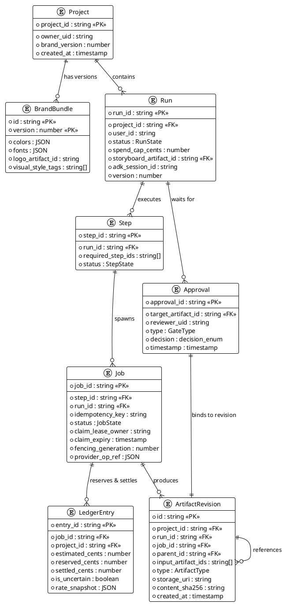
</details>

---

## 10. Financial Ledger & Budget Enforcement Flow

> *"The ledger, not the UI's cost counter, owns spending. Record estimated, reserved, settled, and uncertain amounts per job... Parallel scenes cannot independently pass the same available-balance check."*
>
> — **README.md § Budgets and concurrency**

![Budget Reservation Flow](https://www.plantuml.com/plantuml/svg/ZLHRRzfA47xthvZGFe1EGovDZtIGg4gCQOWYMWL8MpLLjNZ7UCjwrzeT4_BlEskJr4LvE7x0UExppJVpmPDmL1KwEg8S2uHI2sKYlr6c54uKi1BfPkriPMHijNNmQb8_BGkV2saVb5b39hJ7bcRlvWmw-BSbbvY9IjF46fe9pjcvGhr5Kgdel87Eo2cX-OyNnXzxT2gB8lPZjIg58UXSsnNCgrMXl5VMT43uy0clahF9kqaIIK5Y9Jo7lQpa6Wbka5_ktdGdog4dwx1NEpNokgF_uek_SoGxGcU4Xi_ERfMitU_G4UvWD6tSWuQTu-GYYQDeE8IpFep85Yfb5HxV8jU-5SGbmd0OXGgFt-zp3Y3ECTr0bsFymfHWj1LAYvL6k1HQc1JX_H0IJweGX19YwwaN2KqmDRxACYuJkSedsnE8HGd9BXULP_C8dbexveoSU02toNKIB-11KGwNo_77PF4p-NerMiuNoHZGEUlOoLX2S6gTqm2-MBS1vQ5qkELKNCCACqRktgH2wp1iV49ez7bw525FdbCTbiPH3nfl4E8OZv0wvExsciIGUnpSc--kneqJ3k7rMV_TAHC1YNGZEEsVig3Yo8wOfoogEVVZfPPR-CVMPCeL7ADxPRK4RTCDobw4HjQJE-y_pvaHtjhqS6n1oqFZig4KIi8QcTEDKHVxwpxSeONWRyC24VRgi6_xCAzhBm8al3pBfyBfCGGF0vrPLp28iIrAZI4Wjr8pwxcHkpgihQYi21Wo-GZ_mC9kq9nuJAsHK7cnVW7gPIbVmBU5vbd_ulmDj05lyEMRG9NdxxtjZmDo9BiKlV_Zc0TCbRyt3ZNovidwQW0n60s_z_nunZXsmkTCsx7ot8096z2TDqcNPcFiW-dzWM7Nm313UWYabCwM9QSu0TuEP5Z-R-FA_smJXro5VpSVsCQ2e3_i6MpMEXVnU7pEQe3bB4vk5wFf36wceylfpNJnRL0hskJZBPfzMd3WZAyXPweCALrRnTfM4kPfZhBI7Dg5SQPAemS-nf3cmgtnY4sPftKnDM4_y0yVxDy)

> 🔍 **Interactive Links:** [Open Fullscreen SVG](https://www.plantuml.com/plantuml/svg/ZLHRRzfA47xthvZGFe1EGovDZtIGg4gCQOWYMWL8MpLLjNZ7UCjwrzeT4_BlEskJr4LvE7x0UExppJVpmPDmL1KwEg8S2uHI2sKYlr6c54uKi1BfPkriPMHijNNmQb8_BGkV2saVb5b39hJ7bcRlvWmw-BSbbvY9IjF46fe9pjcvGhr5Kgdel87Eo2cX-OyNnXzxT2gB8lPZjIg58UXSsnNCgrMXl5VMT43uy0clahF9kqaIIK5Y9Jo7lQpa6Wbka5_ktdGdog4dwx1NEpNokgF_uek_SoGxGcU4Xi_ERfMitU_G4UvWD6tSWuQTu-GYYQDeE8IpFep85Yfb5HxV8jU-5SGbmd0OXGgFt-zp3Y3ECTr0bsFymfHWj1LAYvL6k1HQc1JX_H0IJweGX19YwwaN2KqmDRxACYuJkSedsnE8HGd9BXULP_C8dbexveoSU02toNKIB-11KGwNo_77PF4p-NerMiuNoHZGEUlOoLX2S6gTqm2-MBS1vQ5qkELKNCCACqRktgH2wp1iV49ez7bw525FdbCTbiPH3nfl4E8OZv0wvExsciIGUnpSc--kneqJ3k7rMV_TAHC1YNGZEEsVig3Yo8wOfoogEVVZfPPR-CVMPCeL7ADxPRK4RTCDobw4HjQJE-y_pvaHtjhqS6n1oqFZig4KIi8QcTEDKHVxwpxSeONWRyC24VRgi6_xCAzhBm8al3pBfyBfCGGF0vrPLp28iIrAZI4Wjr8pwxcHkpgihQYi21Wo-GZ_mC9kq9nuJAsHK7cnVW7gPIbVmBU5vbd_ulmDj05lyEMRG9NdxxtjZmDo9BiKlV_Zc0TCbRyt3ZNovidwQW0n60s_z_nunZXsmkTCsx7ot8096z2TDqcNPcFiW-dzWM7Nm313UWYabCwM9QSu0TuEP5Z-R-FA_smJXro5VpSVsCQ2e3_i6MpMEXVnU7pEQe3bB4vk5wFf36wceylfpNJnRL0hskJZBPfzMd3WZAyXPweCALrRnTfM4kPfZhBI7Dg5SQPAemS-nf3cmgtnY4sPftKnDM4_y0yVxDy) · [Edit on PlantUML Server](https://www.plantuml.com/plantuml/uml/ZLHRRzfA47xthvZGFe1EGovDZtIGg4gCQOWYMWL8MpLLjNZ7UCjwrzeT4_BlEskJr4LvE7x0UExppJVpmPDmL1KwEg8S2uHI2sKYlr6c54uKi1BfPkriPMHijNNmQb8_BGkV2saVb5b39hJ7bcRlvWmw-BSbbvY9IjF46fe9pjcvGhr5Kgdel87Eo2cX-OyNnXzxT2gB8lPZjIg58UXSsnNCgrMXl5VMT43uy0clahF9kqaIIK5Y9Jo7lQpa6Wbka5_ktdGdog4dwx1NEpNokgF_uek_SoGxGcU4Xi_ERfMitU_G4UvWD6tSWuQTu-GYYQDeE8IpFep85Yfb5HxV8jU-5SGbmd0OXGgFt-zp3Y3ECTr0bsFymfHWj1LAYvL6k1HQc1JX_H0IJweGX19YwwaN2KqmDRxACYuJkSedsnE8HGd9BXULP_C8dbexveoSU02toNKIB-11KGwNo_77PF4p-NerMiuNoHZGEUlOoLX2S6gTqm2-MBS1vQ5qkELKNCCACqRktgH2wp1iV49ez7bw525FdbCTbiPH3nfl4E8OZv0wvExsciIGUnpSc--kneqJ3k7rMV_TAHC1YNGZEEsVig3Yo8wOfoogEVVZfPPR-CVMPCeL7ADxPRK4RTCDobw4HjQJE-y_pvaHtjhqS6n1oqFZig4KIi8QcTEDKHVxwpxSeONWRyC24VRgi6_xCAzhBm8al3pBfyBfCGGF0vrPLp28iIrAZI4Wjr8pwxcHkpgihQYi21Wo-GZ_mC9kq9nuJAsHK7cnVW7gPIbVmBU5vbd_ulmDj05lyEMRG9NdxxtjZmDo9BiKlV_Zc0TCbRyt3ZNovidwQW0n60s_z_nunZXsmkTCsx7ot8096z2TDqcNPcFiW-dzWM7Nm313UWYabCwM9QSu0TuEP5Z-R-FA_smJXro5VpSVsCQ2e3_i6MpMEXVnU7pEQe3bB4vk5wFf36wceylfpNJnRL0hskJZBPfzMd3WZAyXPweCALrRnTfM4kPfZhBI7Dg5SQPAemS-nf3cmgtnY4sPftKnDM4_y0yVxDy)

<details>
<summary><b>Click to view PlantUML Source Code</b></summary>

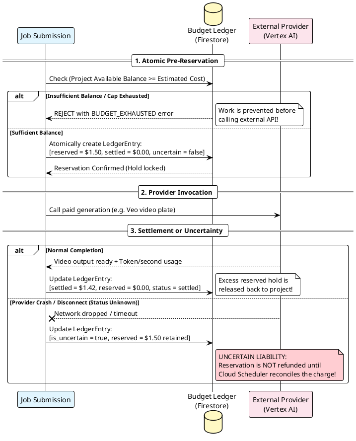
</details>

---

## 11. Baseline Google Models & Provider Routes

VibeShorts features explicit API routing for both Vertex AI (production enterprise) and Gemini Developer API (API key-based development).


> 🔍 **Interactive Links:** [Open Fullscreen SVG](https://www.plantuml.com/plantuml/svg/bPHjRzf03CVVyoayzePAXF5KYV6gj4ifMtaGTEpbP2uctBZSHNUNK3Rrky-4ha3NQMsaI97ji_-sVvSBvz7wB56bTtv52K6gKEgIMqkTeiK45YZMiJMPZgwCCXRUNnVFKSIZqsgoq3coHxJ4JFbhe_q8ENFvXbHENWeiLw7Sin8LVpZKBd1avR9KIhaMnXmv9-lf7de3c9hC4rIkbCaYc6OQFkspdfK17QJh-7k-ZtqVTgxFmu_mgmGW53htb6MGSCuYF9U56s1e8b9TY2cHMWRDsdcmv2EhGEv2YuYPHv-vBlHxS8cEbDHxUtXF8lFIw2xCjbgihD4cSuLhdFaqytncYXlW4NW77s0owhFpuIzHSncHsOlAJqNbP89MhH74n0D5Jq6ztdWcwRcIMwFZW8UZfOvXdEwEiHqgcGi4QMzHDSvE9GudxIeqsylKLQ5_DGDJE5vKEioS57kboQbIjUKTihpcQoUMMegay529bLcWUgRfMsyExSxwvYSBJy4RQ3Lh7NTMY7euWgDVR8r1o4aPRXPwaoTEPYGiUHYYvb0BNsXx02MYlA2t5TQFAJdaEO0IlHsKMufHR5y9oyDBvGz8HFz3WWUPIzgS29WSsOxPc8wXqWmYt0AbknlED03FYBbW_zc_n1os7hsuzLOWb4pV8cIWFTSM1PcyiTFTj-gEcMn1krrhC05_TguDBtLXl3S9cmR3uTUxtkLj29_7bp0RzIQpc_5TbpqXYXMW49HwYk27MG3taA3c9jKMdCRKhGpVHycltP5IXMJNJHMK4SLbgGBg20Ick91A-YspQfPIKOspJybRIGv6uJoSWcFhFkq6KrYGtn1fUBmikoI78HQbNAr4RDsrKhhWB_xN_WO) · [Edit on PlantUML Server](https://www.plantuml.com/plantuml/uml/bPHjRzf03CVVyoayzePAXF5KYV6gj4ifMtaGTEpbP2uctBZSHNUNK3Rrky-4ha3NQMsaI97ji_-sVvSBvz7wB56bTtv52K6gKEgIMqkTeiK45YZMiJMPZgwCCXRUNnVFKSIZqsgoq3coHxJ4JFbhe_q8ENFvXbHENWeiLw7Sin8LVpZKBd1avR9KIhaMnXmv9-lf7de3c9hC4rIkbCaYc6OQFkspdfK17QJh-7k-ZtqVTgxFmu_mgmGW53htb6MGSCuYF9U56s1e8b9TY2cHMWRDsdcmv2EhGEv2YuYPHv-vBlHxS8cEbDHxUtXF8lFIw2xCjbgihD4cSuLhdFaqytncYXlW4NW77s0owhFpuIzHSncHsOlAJqNbP89MhH74n0D5Jq6ztdWcwRcIMwFZW8UZfOvXdEwEiHqgcGi4QMzHDSvE9GudxIeqsylKLQ5_DGDJE5vKEioS57kboQbIjUKTihpcQoUMMegay529bLcWUgRfMsyExSxwvYSBJy4RQ3Lh7NTMY7euWgDVR8r1o4aPRXPwaoTEPYGiUHYYvb0BNsXx02MYlA2t5TQFAJdaEO0IlHsKMufHR5y9oyDBvGz8HFz3WWUPIzgS29WSsOxPc8wXqWmYt0AbknlED03FYBbW_zc_n1os7hsuzLOWb4pV8cIWFTSM1PcyiTFTj-gEcMn1krrhC05_TguDBtLXl3S9cmR3uTUxtkLj29_7bp0RzIQpc_5TbpqXYXMW49HwYk27MG3taA3c9jKMdCRKhGpVHycltP5IXMJNJHMK4SLbgGBg20Ick91A-YspQfPIKOspJybRIGv6uJoSWcFhFkq6KrYGtn1fUBmikoI78HQbNAr4RDsrKhhWB_xN_WO)

<details>
<summary><b>Click to view PlantUML Source Code</b></summary>

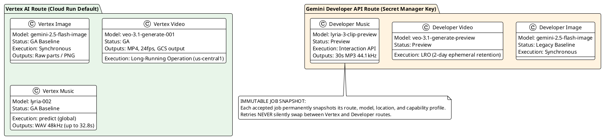
</details>

---

## 12. Implementation Roadmap

```text
┌─────────────────────────────────────────────────────────────────────────────────────────────────┐
│                                    IMPLEMENTATION ROADMAP                                       │
├───────────────────┬───────────────────┬───────────────────┬───────────────────┬─────────────────┤
│ Phase 0           │ Phase 1           │ Phase 2           │ Phase 3           │ Phase 4         │
│ MCP Vertical      │ Agentic Video     │ Iterative         │ Brand             │ Creative Studio │
│ Slices            │ Generation        │ Editing           │ Intelligence      │ Platform        │
├───────────────────┼───────────────────┼───────────────────┼───────────────────┼─────────────────┤
│ • Auth gate       │ • Single ADK      │ • NL and Studio   │ • Automated brand │ • Multi-policy  │
│ • Image slice     │   Creative Dir.   │   revisions       │   consistency     │   presets       │
│ • Veo video slice │ • Firestore ADK   │ • Transitive      │   scoring         │ • Shared team   │
│ • Lyria slice     │   session adapter │   invalidation    │ • Multimodal      │   workspaces    │
│ • HyperFrames     │ • 2 Human gates   │ • Expected-head   │   reference-frame │ • Cross-lingual │
│   package & draft │ • 15s product     │   CAS locking     │   embeddings      │   localization  │
│ • Cloud Run render│   launch MVP      │ • Delta re-render │                   │ • Batch runs    │
└───────────────────┴───────────────────┴───────────────────┴───────────────────┴─────────────────┘
```

---

## Concluding Motto

> *"VibeShorts is a Firebase-gated, brand-aware creative studio where shared MCP/native tools and one director turn a brief into an approved, editable HyperFrames composition and a rendered short."*
